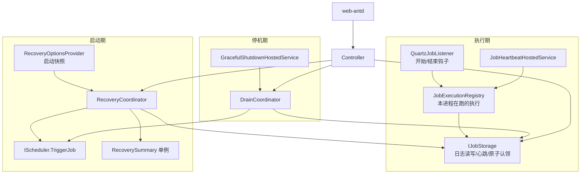

# 中断恢复与排水调度 · 全栈实现方案

> 范围：`Chet.QuartzNet.Models` / `Chet.QuartzNet.Core` / `Chet.QuartzNet.EFCore(+4 Provider)` / `Chet.QuartzNet.UI` / `web-antd`。
> 结论先行：**先改执行日志的生命周期，再谈恢复**。当前 Quartz 用 `UseInMemoryStore`，进程一挂，调度器内部状态全丢；日志又只在执行结束时写一条，所以「哪些任务跑到一半没了」在后端根本不存在。必须先把「开始即落库 + 心跳 + 收尾」做实，中断判定、补偿、排水才有依据。

---

## 一、现状盘点（决定改造顺序）

### 1.1 后端执行链路

| 环节 | 现状 | 影响 |
|---|---|---|
| 启动 | `ApplicationBuilderExtensions` 先 `IJobStorage.InitializeAsync()`（EF 执行 `MigrateAsync`），`AddQuartzHostedService` 自动启动调度器，`JobSchedulerInitializer` 再把作业逐个调度 | 恢复逻辑必须挂在这两步之后 |
| Quartz 状态 | `q.UseInMemoryStore()`（`ServiceCollectionExtensions`） | 崩溃后触发器、运行态全部丢失，恢复只能依赖自建表 |
| 执行入口 | `QuartzJobListener.JobToBeExecuted` 只做暂停/依赖校验，**不写日志** | 运行中的任务在库里完全不可见 |
| 执行出口 | `JobWasExecuted` 才 `AddJobLogAsync`，`StartTime` 用的是 `FireTimeUtc` | 中断时没有任何记录可认领 |
| 手动触发 | `QuartzJobService.TriggerJobAsync` 往 `JobDataMap` 塞 `IsManualTrigger` | 已有「触发来源」的雏形，可扩展 |
| 停止 | `ShutdownSchedulerAsync` 直接 `scheduler.Shutdown(token)`（不等待） | 在跑的任务被硬停，且不留中断痕迹 |
| 日志查询 | `GetJobLogsAsync` 只支持单 `Status` 过滤 | 「中断 + 失败」组合筛选需扩展 |
| 配置 | `SystemConfigDto` 整体序列化进 `quartz_settings` 单键，`GetSystemConfig` 每次现读 | 没有「启动期快照」，无法表达「改了要重启」 |
| 迁移 | `EfCoreMigrationStore`/`FileMigrationWriter` 按实体整体搬运 | 新字段会自动跟随，但目标库必须先升级结构 |
| 统计 | 成功率/失败率只统计 `Success` + `Failed` | 新增中断状态会改变分母，需明确口径 |

### 1.2 前端

5 个薄页面、无 store、页面直连 `api/quartz/*.ts`；日志/作业/配置页 `keepAlive`；状态选项在 `log.vue` 内写了两份；配置保存是整对象覆盖。这些约束在第十节展开。

---

## 二、目标、语义与非目标

### 2.1 要交付的能力

1. 执行开始即产生 `Running` 日志，前端能看见正在跑的任务。
2. 进程崩溃 / 强杀 / 停机超时后，记录可被识别为 `Interrupted`，带最后心跳、失联时长。
3. 下次启动按策略自动补偿：可开关、可延迟、可跳过、可限次、可追溯来源。
4. 排水：停止接收新触发，等待执行中任务收尾，超时后中断并记录；可恢复调度。
5. 作业级三态「中断后自动重跑」（跟随全局 / 开启 / 关闭）。
6. 全存储支持：文件 + MySQL / PostgreSQL / SQLite / SQL Server。
7. 旧数据、旧配置、旧 API 全部兼容。

### 2.2 语义边界（必须写进文档和 UI 提示）

- **不是断点续传**：补偿是整段重跑，不是从中间继续。
- **不是 exactly-once**：补偿语义是 at-least-once，非幂等作业必须关闭自动重跑。这是产品约束，不是实现缺陷。
- **不保证跨节点调度**：Quartz 仍是内存存储，每个实例各跑各的；多实例只共享作业定义与日志表，恢复靠日志行原子认领。
- **不做跨版本结构自动降级**：升级后结构只向前兼容。

### 2.3 非目标

- 不引入 Quartz JDBC/Redis 持久化。
- 不做任务分片、分布式锁调度。
- 本次不改分析页指标（后续可加「中断次数 / 补偿成功率」）。

---

## 三、总体架构



### 3.1 组件职责

| 组件 | 层 | 生命周期 | 职责 |
|---|---|---|---|
| `JobExecutionRegistry` | Core | Singleton | 本进程正在执行的 `logId ↔ 作业/实例/开始时间`；进程内真值来源 |
| `JobExecutionLogService` | Core | Scoped | 创建 Running 日志、收尾、心跳批量更新、veto 兜底 |
| `JobHeartbeatHostedService` | UI | Hosted | 每 `heartbeatInterval` 把注册表里的 logId 批量续期 |
| `RecoveryOptionsProvider` | Core | Singleton | 启动时把配置读成不可变快照，进程内不再变 |
| `RecoveryCoordinator` | Core | Singleton | 扫描/认领/策略/补偿/汇总；状态机 + 并发保护 |
| `DrainCoordinator` | Core | Singleton | 排水状态机；Standby、等待、超时、恢复 |
| `GracefulShutdownHostedService` | UI | Hosted | 应用停止时执行排水/等待，最后标记残留执行 |
| `RecoveryHostedService` | UI | Hosted | 在调度器与作业加载完成后，延迟启动恢复流程 |

> Hosted service 放 UI 层：Core 没有 `Microsoft.Extensions.Hosting.Abstractions` 引用，业务逻辑仍留在 Core，UI 只做编排与定时。
>
> 生命周期约定：Singleton 组件（Registry / Coordinator）不能直接注入 Scoped 的 `IJobStorage`，统一通过 `IServiceScopeFactory` 开短作用域访问存储，用完即释放。
>
> 另一个坑：**不要长期持有 `IScheduler`**。`QuartzJobService.StartSchedulerAsync` 在 Shutdown 后会通过 `ISchedulerFactory.GetScheduler()` 重建实例，而 DI 里注册的 `IScheduler` 单例仍指向已关闭的旧对象。`DrainCoordinator`、`RecoveryCoordinator` 与状态查询必须每次操作时现取 `GetScheduler()`，或统一走 `IQuartzJobService` 的封装。

### 3.2 启动顺序（`ServiceCollectionExtensions` 注册顺序即启动顺序）

```
存储初始化
  → QuartzHostedService 启动调度器
  → JobSchedulerInitializer 调度作业
  → JobHeartbeatHostedService 启动心跳
  → RecoveryHostedService 延迟 N 秒后执行恢复
  → LogCleanupHostedService 日志清理
```

停止顺序相反：`GracefulShutdownHostedService` 最后注册 → 最先停止，能在 Quartz 关闭前完成排水等待。

---

## 四、数据模型与存储

### 4.1 `QuartzJobLog` 新增字段

| 字段 | 类型 | 默认 | 用途 | 索引 |
|---|---|---|---|---|
| `InstanceId` | `string(64)` | `""` | 产生该记录的实例标识（机器名+进程号+启动短 id） | — |
| `BootId` | `Guid?` | null | 本次进程启动标识，区分「同一实例上一次运行」 | — |
| `TriggerType` | `enum` | `Cron` | Cron / Manual / Recovery | — |
| `TriggeredBy` | `string(100)?` | null | 手动触发的操作人 | — |
| `RecoverySourceLogId` | `Guid?` | null | 补偿记录指向被补偿的中断记录 | 有 |
| `RecoveryAttempt` | `int` | 1 | 第几次尝试；补偿 = 源 +1 | — |
| `HeartbeatTime` | `DateTime?` | null | 最后一次心跳 | 组合 |
| `InterruptedAt` | `DateTime?` | null | 判定中断的时刻 | — |
| `CompensationStatus` | `enum` | `None` | None/Pending/Triggered/Skipped/Failed | 组合 |
| `CompensationLogId` | `Guid?` | null | 本次补偿产生的日志 | — |
| `SkipReason` | `string(500)?` | null | 跳过补偿的原因 | — |

索引：

```
idx_log_recovery   (Status, HeartbeatTime)
idx_log_compensation (Status, CompensationStatus)
idx_log_recovery_source (RecoverySourceLogId)
```

字段语义约定：

- `Running` 行：`EndTime/Duration` 为空，`HeartbeatTime` 由心跳续期。
- `Interrupted` 行：`EndTime = 最后心跳`，`Duration = 最后心跳 - StartTime`，`Message` 写中断原因。
- 补偿行：普通执行记录，`TriggerType=Recovery`，通过 `RecoverySourceLogId` 指回源记录；源记录的 `CompensationLogId` 指向它，双向可查。

### 4.2 `QuartzJobInfo` 新增字段

| 字段 | 类型 | 默认 | 说明 |
|---|---|---|---|
| `RerunOnRecovery` | `bool?` | `null` | null=跟随全局；true/false=作业级显式 |

EF 配置：可空 bool，无默认值；已有行自动为 null。文件存储的 JSON 反序列化天然兼容缺省。

### 4.3 枚举

```csharp
public enum LogStatus { Running = 0, Success = 1, Failed = 2, Skipped = 3, Interrupted = 4 }

public enum TriggerType { Cron = 0, Manual = 1, Recovery = 2 }

public enum CompensationStatus { None = 0, Pending = 1, Triggered = 2, Skipped = 3, Failed = 4 }
```

- `LogStatus` 保持数值序列化，前端枚举按数值对齐。
- `TriggerType` / `CompensationStatus` 建议加 `[JsonConverter(typeof(JsonStringEnumConverter))]`，接口可读性更好；若担心前端改动量，也可统一数值，二者择一，不能混。

### 4.4 迁移

四个 Provider 各加一个迁移（列名沿用现有 PascalCase）：

```
AddRecoveryAndDrainFields
  quartz_jobs      + RerunOnRecovery (nullable bool)
  quartz_job_logs  + 上述 11 列
  + 3 个索引
```

要点：

- 全部新列可空或有默认值，老库可直接升级；老版本代码读新库会忽略多余列，可回滚。
- SQLite 加列 + 建索引可用；MySQL 的 `text` 列不受影响。
- 迁移在启动时 `MigrateAsync` 自动执行；生产环境建议先在备份库演练一次。
- 数据迁移功能（文件 ↔ 库、库 ↔ 库）会自动带上新字段，但**目标库必须先由新版本启动过一次完成迁移**，否则写新字段会失败。

### 4.5 `IJobStorage` 新增方法

| 方法 | 语义 | 原子性要求 |
|---|---|---|
| `UpdateJobLogAsync(QuartzJobLog log)` | 收尾更新 | 按 `LogId` 全量更新 |
| `UpdateJobLogHeartbeatsAsync(IReadOnlyCollection<Guid> ids, DateTime now)` | 批量续期 | 幂等；一条 SQL / 一次文件写 |
| `GetRecoverableLogsAsync(DateTime staleBefore, int limit)` | 查候选：`Running && 心跳过期` 或 `Interrupted && Pending` | 只读 |
| `TryMarkInterruptedAsync(Guid logId, string instanceId, DateTime now, string reason)` | 认领并标中断 | **条件更新**：仅当 `Status=Running`；返回是否抢到 |
| `TryClaimCompensationAsync(Guid logId)` | 抢占补偿权 | 仅当 `Status=Interrupted && CompensationStatus != Triggered` |
| `MarkCompensationResultAsync(Guid logId, CompensationStatus status, Guid? compensationLogId, string? reason)` | 回写策略结果 | 幂等 |
| `ClearExpiredLogsAsync(int days, int interruptedDays)` | 过期清理 | 保留 `Pending` 与补偿链 |
| `ClearOverflowLogsAsync(int maxCount, bool keepRecoveryChain)` | 条数清理 | 保留 `Pending` 与补偿链 |

`GetJobLogsAsync` 需要支持 `Statuses`（多状态）过滤，File 与 EF 同步实现；否则「仅看需要处理」只能前端过滤，分页和总数会错。

> 兼容性：`IJobStorage` 是公开 NuGet 契约，新增成员对第三方自定义存储是破坏性变更。P0 需二选一：
> **A. 直接扩接口**（与现有 `AddJobsBatchAsync` 等演进口径一致），发布说明标注 breaking；
> **B. 新增 `IRecoveryCapableJobStorage` 能力接口**，内置 File/EF 实现，`RecoveryCoordinator` 做能力探测，缺失时只关闭恢复能力、不影响原有功能。
> 建议 B：多一个接口，但老宿主升级不会编译失败。

### 4.6 存储实现差异

| 能力 | 文件存储 | EF 存储 |
|---|---|---|
| 心跳 | 读整个 `logs.json` → 改 → 写回，持文件锁 | 一条 `ExecuteUpdate` |
| 认领 | 锁内二次校验状态后修改 | `Where(...).ExecuteUpdateAsync()` 返回影响行数 |
| 候选扫描 | 内存过滤，注意分批 | `Where + OrderBy + Take` |
| 性能 | 心跳会放大整文件写；建议心跳间隔 ≥ 15s，且只在有执行时写 | 索引覆盖，成本可控 |

> 文件存储是本方案的性能短板：日志文件随历史增长，心跳写会整文件重写。文档中明确「高频、多任务场景建议数据库存储」，不做额外架构（如把心跳拆到独立文件）以免过度设计。

---

## 五、执行日志生命周期（核心改造）

### 5.1 钩子时序

`JobToBeExecuted` 现有逻辑是「暂停校验 → 依赖校验 → 抛异常阻止」。改造后：

```
JobToBeExecuted
  ├─ 手动 / 补偿触发 → 跳过暂停与依赖校验（执行资格已在原执行时获得）
  ├─ 定时触发 → 暂停校验（不通过 → 抛异常，走 Veto，不建 Running 行）
  ├─ 定时触发 → 依赖校验（不通过 → 写 Skipped 行并抛异常，不建 Running 行）
  └─ 通过 → 创建 Running 行（或认领补偿预建行）→ 注册到 Registry → logId 写入 JobDataMap

作业执行（可能被 RetryJobWrapper 包裹）

JobWasExecuted
  ├─ 有 logId → Update 收尾（Success/Failed + 耗时 + 异常 + 结果）
  └─ 无 logId → 兜底新增（保留旧行为，兼容异常路径）

JobExecutionVetoed
  ├─ 有 logId → Update 为 Failed（原因：被否决）
  └─ 无 logId → 新增 Failed（保持现状）
```

关键点：

- **Running 行必须最后创建**：放在所有「会抛异常阻止执行」的校验之后，避免校验失败留下僵尸 Running。
- **依赖跳过不再新增第二条日志**：现有代码先写 Skipped 再抛异常，`JobWasExecuted` 靠 `__DependencySkipReason` 跳过；改造后保持这条路径不变，但确保没有 Running 行。
- **Veto 必须能收尾**：`JobExecutionVetoed` 优先按 logId 更新，避免「已建行但被否决」留下 Running。

### 5.2 JobDataMap 协议

新增常量（`QuartzJobConst`）：

```
LogId             = "__QuartzLogId"        // 预建/已建日志 id
TriggerType       = "__QuartzTriggerType"  // Cron/Manual/Recovery
RecoverySourceId  = "__QuartzRecoverySourceLogId"
RecoveryAttempt   = "__QuartzRecoveryAttempt"
IsManualTrigger   = "IsManualTrigger"      // 现有，保留
```

约定：

- 定时触发：数据来自 `ScheduleJobAsync` 的 `JobDataMap`，没有 `TriggerType` 时默认 `Cron`。
- 手动触发：`TriggerJobAsync` 写 `Manual` + `TriggeredBy`。
- 补偿触发：`RecoveryCoordinator` 写 `Recovery` + 源 id + attempt，并**预建** Running 行、把 logId 放进 map。
- 开始钩子拿到 logId 时，不做插入，只刷新一次心跳并注册。
- 监听器判断来源以 `TriggerType` 为准，`IsManualTrigger` 仅用于兼容旧路径与旧数据，不再作为唯一判据。

> **必须同时修掉的一个既有隐患**：`TriggerJobAsync` 在「作业不在调度器」的兜底分支里，把带有 `IsManualTrigger=true` 的同一个 map 同时用于 `jobBuilder.UsingJobData(...)`。这会把执行级标记永久写进 JobDetail，后续 Cron 触发也会被当成手动触发。改造时拆成两份：
> - 持久 map：原始 `JobData` + 重试参数 → `JobBuilder.UsingJobData`
> - 执行 map：持久 map + `LogId/TriggerType/RecoverySourceId/RecoveryAttempt/IsManualTrigger` → `TriggerJob(key, executionMap)`
>
> 新增的恢复键同理，绝不能进入 JobDetail。

### 5.3 心跳

- `JobHeartbeatHostedService` 每 `HeartbeatIntervalSeconds` 执行一次，取 Registry 中所有活跃 logId，调用批量续期。
- 心跳只在有活跃执行时写库，空闲零开销。
- 心跳失败不阻断作业，记录 warn；连续失败超过 3 次在 UI 侧体现为「心跳停滞」，由中断检测兜底。
- 租约判定：`now - heartbeat > LeaseDurationSeconds` 才算过期；配置校验强制 `lease >= 2 × heartbeat`，默认 60/15，等价 4 个心跳周期容错。

### 5.4 收尾

- `Duration` 改为 `now - log.StartTime`（不再用 `FireTime`，避免触发器延迟算进执行时长）。
- 收尾后从 Registry 移除。
- 通知服务、`UpdateJobExecutionTimesAsync` 逻辑不变。
- `JobWasExecuted` 现有整体 try/catch 吞异常，保留；但日志写入失败要打 error 级，便于发现「恢复依据缺失」。

### 5.5 兼容与降级

- 旧数据没有新字段：查询、展示按缺省处理。
- 旧版本升级瞬间仍在跑的任务由旧代码写结束日志，不会产生 Running 行，恢复扫描自然忽略。
- 若 Running 写入失败：作业照常执行，只记 warning；该次执行失去中断保护，但不影响业务。

---

## 六、中断判定与启动补偿

### 6.1 判定规则（唯一依据：日志行 + 心跳）

一条日志被视为中断，当且仅当：

1. `Status == Running`；
2. `(HeartbeatTime ?? StartTime) < now - LeaseDurationSeconds`；
3. 且 `TryMarkInterruptedAsync` 条件更新成功（防止多实例重复处理）。

补充规则：

- 本进程正在执行的行不会被误判：心跳持续续期，天然满足 `heartbeat >= staleBefore`；无需额外按 BootId 排除（可作为双保险）。
- 若 `HeartbeatTime` 为空（极端旧数据/写入缺失），以 `StartTime` 判定。
- 判定不使用 Quartz 的 `GetCurrentlyExecutingJobs`：它只反映本进程，无法覆盖崩溃实例。

### 6.2 扫描与认领

```
staleBefore = now - lease

候选 = 
  (Status = Running AND COALESCE(HeartbeatTime, StartTime) < staleBefore)
  OR
  (Status = Interrupted AND CompensationStatus = Pending)   // 上次补偿中途崩溃

按 StartTime 升序，分批 200 条
```

逐条认领：

```
TryMarkInterruptedAsync(logId, instanceId, now, reason):
  UPDATE ... SET Status = Interrupted,
                 InterruptedAt = now,
                 EndTime = COALESCE(HeartbeatTime, StartTime),
                 Duration = (COALESCE(HeartbeatTime, now) - StartTime),
                 CompensationStatus = Pending
  WHERE LogId = @id AND Status = Running
```

影响行数为 0 表示已被其他实例处理，跳过。文件存储在同一把锁内做「读-判-写」，语义一致。

### 6.3 补偿决策（按顺序短路）

| # | 条件 | 结果 | SkipReason |
|---|---|---|---|
| 1 | 全局 `RecoveryEnabled = false` | 只标中断，不补偿 | 自动补偿已关闭 |
| 2 | 已有 `CompensationStatus = Triggered` | 跳过 | 已补偿 |
| 3 | `RecoveryAttempt >= MaxRecoveryAttempts` | 跳过 | 超过最大补偿次数，疑似启动即崩 |
| 4 | 作业不存在 | 跳过 | 作业已删除 |
| 5 | 作业 `IsEnabled = false` | 跳过 | 作业已禁用 |
| 6 | 作业 `RerunOnRecovery == false` | 跳过 | 作业已关闭自动重跑 |
| 7 | `SkipIfNextFireWithinSeconds > 0` 且距下次触发不足 | 跳过 | 临近下次触发 |
| 8 | `CatchUpStrategy = None` | 跳过 | 策略为不补偿 |
| 9 | `CatchUpStrategy = Latest` 且同作业有更新的中断记录 | 跳过 | 已有更新的中断记录 |
| 10 | 触发失败 | 失败 | 异常消息 |

补充决策（建议，需拍板）：

- **暂停中的作业仍然补偿**：这次执行在崩溃前已经被授权，暂停不应追溯取消；禁用/删除才跳过。
- **手动「重新执行」不受全局开关与作业开关限制**：人工操作是显式覆盖，但要在确认框里提示风险。
- **`CatchUp = All` 默认不推荐**：可能出现瞬时补偿风暴，保存时二次确认。

### 6.4 补偿触发

```
1. TryClaimCompensationAsync(sourceLogId)      // Pending/Skipped/Failed/None → Triggered
2. 预建补偿日志：
     Status = Running, StartTime = now,
     TriggerType = Recovery,
     RecoverySourceLogId = source.LogId,
     RecoveryAttempt = source.Attempt + 1,
     InstanceId/BootId = 当前,
     HeartbeatTime = now
3. scheduler.TriggerJob(jobKey, dataMap)
     dataMap: LogId=新日志, TriggerType=Recovery, RecoverySourceId, RecoveryAttempt
4. 成功：源日志 CompensationStatus=Triggered, CompensationLogId=新日志
   失败：新日志置 Failed（写异常），源日志置 Failed，继续处理下一条
```

为什么预建日志：触发是异步的，若在「触发后、执行前」进程再次崩溃，预建行会被下一轮扫描按中断处理，形成 attempt+1 的链，不会丢账。

三个必须处理的实现细节：

1. **暂停/禁用作业不在调度器里**。`JobSchedulerInitializer` 启动时会跳过这两类作业，直接 `scheduler.TriggerJob` 会因 JobKey 不存在而失败。补偿必须复用 `TriggerJobAsync` 的「先确保作业已注册，再触发」兜底逻辑。
2. **监听器的暂停/依赖预检会拦掉补偿**。补偿数据带 `TriggerType=Recovery` 时，`JobToBeExecuted` 应跳过暂停校验与依赖校验——这次执行在崩溃前已经通过校验，补偿是补做而不是重新申请执行资格；否则「补偿暂停作业」的决策无法落地。
3. **dataMap 不能只放恢复键**。必须复用 `CreateJobDataMapWithManualTrigger` 的组装逻辑得到执行 map（原始 `JobData`、重试参数、并发兜底），再追加恢复键；若走兜底注册，持久 map 与执行 map 必须分离（见 5.2），否则恢复键会永久写进 JobDetail。

`DisallowConcurrentExecution` 的作业由 Quartz 自行排队；`Latest` 策略已避免同一作业堆积多条补偿。

前置守卫：若 `scheduler.IsStarted == false`（用户先点了「停止调度器」，或宿主未自动启动），本轮只标记中断、不触发补偿，汇总里保持 `Pending`；用户点击「启动调度器」后由 `StartSchedulerAsync` 追加一次补偿扫描。

### 6.5 手动重新执行

- 接口：`POST /api/quartz/RerunInterruptedLog`，参数 `{ logId }`。
- 校验：日志存在、`Status = Interrupted`、`CompensationStatus != Triggered`。
- 复用 6.4 的流程，`TriggeredBy = 当前登录用户`，来源标记为手动补偿。
- 已补偿 → 返回 `409 + LOG_ALREADY_COMPENSATED`，前端刷新列表即可，不弹系统错误。
- 作业已删除 → `404 + JOB_NOT_FOUND`。

### 6.6 汇总与实例语义

`RecoverySummary` 单例保存本次启动的结果：

```
BootId, InstanceId, BootTime, StartedAt, CompletedAt, IsRunning,
InterruptedCount, RerunCount, SkippedCount, FailedCount, PendingCount,
Details[<=100]: { LogId, JobName, JobGroup, Attempt, Outcome, Reason }
```

- `InterruptedCount` = 本次新判定 + 上次遗留 Pending 接手。
- 汇总只在内存，进程重启即重置，正好对应「本次启动」提示。
- 多实例部署时是**实例级**，不是集群级；浏览器命中哪个实例就看到哪个实例的汇总。若需要集群汇总，后续加实例注册表，本次不做。

### 6.7 边界

| 场景 | 行为 |
|---|---|
| 补偿执行再次崩溃 | 新日志变 Interrupted，attempt+1，直到上限 |
| 启动即崩循环 | `MaxRecoveryAttempts` 截断，留 skipReason |
| 多实例同时启动 | 条件更新只有一方成功，另一方跳过 |
| 时钟漂移 | 默认租约 4 个心跳周期；要求 NTP，文档写明 |
| 任务真实执行超过租约 | 心跳续期，不会误判 |
| 补偿时作业被改 Cron | 用当前调度器中的作业触发，Cron 不参与补偿 |
| 日志被手动清空 | 中断记录中 `CompensationStatus in (None, Pending)` 需保留，见 8.3 |

---

## 七、排水与优雅停机

### 7.1 三种停机语义

| 操作 | 停止接新触发 | 等待执行中 | Quartz 状态 | 可恢复 |
|---|---|---|---|---|
| 停止调度器（现有） | 是 | 否（`Shutdown` 不等待） | Shutdown | 重新 Start |
| 排水（新增） | 是 | 是，有超时 | Standby → Shutdown | 排水未完成可恢复 |
| 应用关闭 | 是 | 按配置 | Standby → Shutdown | 下次启动恢复 |

### 7.2 状态机

```
Running --BeginDrain--> Draining --全部完成/超时--> Stopping --> Stopped
Draining --Resume--> Running
Running --Stop--> Stopped
```

`DrainCoordinator` 状态字段：

```
IsDraining, StartedAt, Deadline, InitialExecutingCount,
RemainingExecutingCount, PendingCompensationCount, DrainTask
```

实现要点：

1. `BeginDrain`：加锁校验（已启动、未关闭、未排水）→ `scheduler.Standby(token)` → 记录起始执行数 → 启动后台监视任务。
2. 监视：每 500ms~1s 调 `GetCurrentlyExecutingJobs()`；归零 → `scheduler.Shutdown(true)` → 状态 Stopped。
3. 超时：`scheduler.Shutdown(false)`，并把本进程仍在执行的登记项标为 Interrupted（原因「排水超时」），交由下次启动补偿。
4. `Resume`：仅 `Draining` 状态可用；`scheduler.Start(token)`，清空排水状态，未完成的任务继续跑，触发器恢复。已到 `Stopped` 的走「启动调度器」，不能对 Shutdown 的调度器调 Start。
5. 排水期间：
   - `TriggerJobAsync` 直接返回失败 `SCHEDULER_DRAINING`；
   - 批量启停、增删改作业允许（不影响触发面）；
   - `GetSchedulerStatus` 返回 `isDraining` + 剩余数。
6. 幂等：重复 `BeginDrain` 返回「已在排水」；对已停止的调度器排水返回明确错误。

### 7.3 应用关闭钩子

`GracefulShutdownHostedService.StopAsync`：

```
读取 EffectiveOptions.ShutdownMode
  Immediate → 直接返回（Quartz 自己关）
  Drain     → Standby，最多等 DrainTimeoutSeconds 或直到执行数归零，超时标中断
  Wait      → Standby，最多等 ShutdownWaitTimeoutSeconds，超时标中断
```

注意事项：

- 现状已有 `AddQuartzHostedService(o => o.WaitForJobsToComplete = true)`，应用关闭本身会等待任务完成；但它**没有超时控制、没有排水状态、也不标记残留**，且受宿主 `ShutdownTimeout` 约束。新钩子的价值是「可控超时 + 状态可见 + 残留标记」，不是从零实现等待。
- 该服务必须**最后注册**，停止时最先执行，才能赶在 Quartz `StopAsync` 之前完成等待。
- 宿主的 `HostOptions.ShutdownTimeout` 默认 30 秒，会先于自定义等待触发；配置值必须小于它，或指引用户调大宿主超时。文档写清楚，不做自动修改。
- 强杀（SIGKILL / 进程崩溃）不会走钩子，只能靠下次启动扫描；两条路径的最终结果一致。
- 等待期间停止心跳会误判，因此心跳服务应在此之后才停（注册顺序更早 → 停止更晚），或由 Coordinator 主动延长租约。

### 7.4 与现有停止按钮的关系

- 「停止调度器」保持现状（立即停止），但在 UI 上明确提示「不会等待执行中的任务，可能产生中断记录」。
- 需要平滑时用「排水」。
- 排水完成后自动进入 Stopped，UI 状态条自行回落，无需用户再点停止。

---

## 八、配置

### 8.1 字段

| 分组 | 字段 | 默认 | 校验 | 生效 |
|---|---|---|---|---|
| 停机 | `ShutdownMode` | `Drain` | `Immediate/Drain/Wait` | 需重启 |
| 停机 | `ShutdownWaitTimeoutSeconds` | 30 | 0–3600，且 < 宿主 ShutdownTimeout | 需重启 |
| 停机 | `DrainTimeoutSeconds` | 60 | 0–3600 | 需重启 |
| 恢复 | `RecoveryEnabled` | true | — | 需重启 |
| 恢复 | `CompensationDelaySeconds` | 30 | 0–3600 | 需重启 |
| 恢复 | `HeartbeatIntervalSeconds` | 15 | 5–300 | 需重启 |
| 恢复 | `LeaseDurationSeconds` | 60 | 10–3600，≥ 2×心跳 | 需重启 |
| 恢复 | `SkipIfNextFireWithinSeconds` | 120 | 0–86400 | 需重启 |
| 恢复 | `CatchUpStrategy` | `Latest` | `None/Latest/All` | 需重启 |
| 恢复 | `MaxRecoveryAttempts` | 3 | 1–10 | 需重启 |
| 恢复 | `DefaultRerunOnRecovery` | true | — | 需重启 |
| 恢复 | `InterruptedLogRetentionDays` | 30 | 0–3650 | 下次启动 |

### 8.2 生效快照

- `RecoveryOptionsProvider` 是单例，不能直接注入 Scoped 的 `IJobStorage`。通过 `IServiceScopeFactory` 在启动阶段开作用域读取一次，或由 `RecoveryHostedService` 读取后调用 `Initialize(config)`；之后固化为不可变记录，进程内不再刷新。
- `GetSystemConfigAsync` 返回：持久化配置 + `EffectiveConfig` + `RestartRequired` + `BootTime`。
- `SaveSystemConfigAsync` 是**全量覆盖**语义（C# 模型绑定缺失字段会回落默认值），只落库、不改变当前运行值；服务端校验范围、`lease >= 2×心跳`、枚举合法，非法直接拒绝，不做静默纠正。
- 老 JSON 缺字段 → 用默认值补齐，不报错。
- `RestartRequired` 由持久化值与快照逐字段比较得出，前端高亮差异项。

### 8.3 与日志清理的关系

现有 `LogCleanupHostedService` 按 `LogRetentionDays` / `LogMaxCount` 清理。新增规则：

1. `CompensationStatus in (None, Pending)` 的中断记录**永不自动清理**（否则丢补偿依据）。
2. 已处理完的中断记录与补偿链按 `InterruptedLogRetentionDays` 清理。
3. 条数清理需要排除上述保护集，避免把待补偿记录挤掉。
4. 手动「清空日志」同样跳过 `Pending` 记录，前端提示「已保留 N 条待补偿记录」。

实现上给存储方法加参数，避免在 UI 层做过滤（数据量）。

---

## 九、API 契约

### 9.1 扩展 `GetSchedulerStatus`

```json
{
  "isStarted": true,
  "isShutdown": false,
  "inStandbyMode": true,
  "isDraining": true,
  "drainStartedAt": "2026-11-13T10:00:00",
  "drainDeadline": "2026-11-13T10:01:00",
  "remainingExecutingCount": 1,
  "pendingCompensationCount": 0,
  "executingJobCount": 1
}
```

`status` 字段在排水期间必须返回「排水」而不是「待机」，前端以 `isDraining` 为准，文案不靠猜。

### 9.2 新增接口

| 方法 | 路径 | 请求 | 返回 | 错误码 |
|---|---|---|---|---|
| POST | `/api/quartz/DrainScheduler` | `{ timeoutSeconds? }` | `ApiResponseDto<bool>` | `SCHEDULER_NOT_STARTED`、`SCHEDULER_ALREADY_DRAINING` |
| POST | `/api/quartz/ResumeScheduler` | — | `ApiResponseDto<bool>` | `SCHEDULER_NOT_DRAINING` |
| GET | `/api/quartz/GetRecoverySummary` | — | `ApiResponseDto<RecoverySummaryDto>` | — |
| POST | `/api/quartz/RerunInterruptedLog` | `{ logId }` | `ApiResponseDto<bool>` | `LOG_NOT_FOUND`、`LOG_NOT_INTERRUPTED`、`LOG_ALREADY_COMPENSATED`、`JOB_NOT_FOUND` |
| POST | `/api/quartz/GetJobLogs` | 增加 `statuses?: number[]` | 同现有 | — |

`GetRecoverySummary` 响应（前端去重依赖 `bootId`）：

```json
{
  "bootId": "guid",
  "instanceId": "MACHINE-01:12345",
  "bootTime": "2026-11-13T10:00:00",
  "startedAt": "2026-11-13T10:00:30",
  "completedAt": "2026-11-13T10:00:40",
  "isRunning": false,
  "interruptedCount": 2,
  "rerunCount": 1,
  "skippedCount": 1,
  "failedCount": 0,
  "pendingCount": 0,
  "details": [
    { "logId": "guid", "jobName": "SyncOrders", "jobGroup": "DEFAULT", "attempt": 2, "outcome": "Rerun", "reason": null }
  ]
}
```

`details` 最多 100 条，超出时置 `truncated: true`。

### 9.3 日志 DTO 新增

```json
{
  "triggerType": "Cron | Manual | Recovery",
  "triggeredBy": "admin",
  "recoverySourceLogId": "guid",
  "recoverySourceStartTime": "2026-11-13T06:00:00",
  "recoveryAttempt": 2,
  "heartbeatTime": "2026-11-13T10:00:00",
  "interruptedAt": "2026-11-13T10:05:00",
  "compensationStatus": "None | Pending | Triggered | Skipped | Failed",
  "skipReason": "临近下次触发"
}
```

> `GetJobLogs` 当前直接返回实体 `QuartzJobLog`，新增字段会自动出现在响应里；`QuartzJobLogDto` 若后续启用，需要同步补齐。

### 9.4 作业 DTO 新增

```
rerunOnRecovery: boolean | null        // 请求与详情
effectiveRerunOnRecovery: boolean      // 列表/详情只读，后端按全局解析
```

落地位置：`AddJobAsync` 与 `UpdateJobAsync` 各有一处实体赋值，`MapToResponseDto` 一处映射；effective 由 `RecoveryOptionsProvider` 的快照与作业值合并得出，前端不再自己推断。

---

## 十、前端改造

前端不是独立改造，而是按第九节契约做增量实现；以下只列与全栈契约强相关的行为，组件内部实现按现有代码习惯处理。

### 10.1 日志页 `log.vue`

- 状态映射加 `Interrupted = 4`（洋红 `magenta`），列表/筛选/详情共用同一份 `LOG_STATUS_META`，消灭现有两份硬编码。
- 新增「触发来源」列：Cron / 手动 / 补偿重跑；补偿用 Popover 展示原执行时间与第 N 次尝试。
- 操作列加「重新执行」，仅中断行可见，行级 loading，成功/失败都刷新当前页；409 只提示不报错。
- 详情弹窗：中断洋红、补偿青色 + 灰色来源说明；补贴「最后心跳 / 失联时长 / 补偿状态 / 跳过原因」。
- 筛选：状态下拉加「中断」；新增「仅看需要处理」开关（提交 `statuses: [2,4]`，与状态选择互斥）。
- 运行中行：本地 1 秒 ticker 显示「已运行 xx」；页面可见且有 Running 行时每 5 秒静默刷新。
- 深链 `/log?status=4&needsAttention=1`：`keepAlive` 页面要在 `onActivated` 应用，query 优先于 localStorage，应用后清理 URL。

### 10.2 作业页 `job.vue`

- 顶部状态条增加排水徽标，文案「排水模式 · 等待 N 个任务完成」，N 取 `remainingExecutingCount`，缺失时回退 `executingJobCount`。
- 按钮：启动（`isStarted || isDraining` 禁用）、停止（原有，排水期间确认文案强调会中断）、排水、恢复调度。
- 排水期间 3 秒轮询 `GetSchedulerStatus`，结束后停表并刷新列表。
- 编辑弹窗新增三态 `Select`：跟随全局 `null` / 开启 `true` / 关闭 `false`；布局调整为 Cron 12 / 禁止并发 6 / 自动重跑 6。
- 作业字段在 5 处副本中全部补齐：初始 reactive、`handleAdd`、`handleCopyJob`、`handleEdit`、`handleSave`；读写统一 `?? null`，禁止 `|| false`。
- 列表状态列后加 60px 图标列：⚡ / ⊘ / —，tooltip 三态，用 `effectiveRerunOnRecovery`。

### 10.3 配置页 `system-config.vue`

- 在「基础信息」与「数据迁移」之间新增独立 Card，左右布局：表单 + 只读「当前生效值」。
- 每项带生效方式徽标（即时 / 下次启动 / 需重启）与灰色帮助文案。
- 保存提交完整对象（含原有字段），服务端也做全量校验；`lease < 2×heartbeat` 就地拦截。
- 保存后重新拉取配置，展示「已保存，重启后生效」与差异高亮；`CatchUp = All` 二次确认。
- 老后端不返回 `effectiveConfig` 时隐藏右栏，不影响表单。

### 10.4 全局提示

- `layouts/basic.vue` 的 `#extra` 挂载 `RecoveryNotice`，挂载后请求一次 `GetRecoverySummary`。
- 若返回 `isRunning = true`（补偿还在延迟/执行中），最多再轮询 3 次、间隔 2 秒；仍为 true 就按当前已处理数提示，不无限等待。
- 去重键 `quartz-recovery-notice:{bootId}`（接口返回 `bootId`），刷新不重复、重启再提示。
- 文案：「本次启动检测到 N 个中断执行，已自动重跑 X 个，跳过 Y 个，失败 Z 个」；有失败用 error 语气。
- 「查看详情」跳日志页深链；关闭或跳转都写去重键。
- 接口缺失/失败静默跳过，不阻塞首屏。

### 10.5 前端公共层

- `api/quartz/*.ts` 补类型与函数，所有后端字段适配只在这一层。
- i18n 中英双语一次补齐（`zh-CN/page.json`、`en-US/page.json`）。
- 不引入 store；跨页只通过路由 query。

---

## 十一、实施计划

| 阶段 | 内容 | 依赖 | 交付信号 | 预估 |
|---|---|---|---|---|
| P0 | 冻结枚举/字段/接口签名；确定 `IJobStorage` 扩接口还是加能力接口；补 ADR：补偿语义、at-least-once、实例级汇总 | — | 本文评审通过 | 0.5d |
| P1 | 实体 + DTO + `IJobStorage` 新方法 + File/EF 实现 + 4 个迁移 | P0 | 空实现可编译；老库升级成功；单测覆盖认领原子性 | 2d |
| P2 | 执行日志生命周期：开始落库、veto 收尾、心跳、结束更新、Registry | P1 | 页面上能看到 Running，结束后变成 Success/Failed | 2d |
| P3 | 中断判定 + 启动补偿 + 策略 + 汇总 + 手动重跑 | P2 | 杀进程重启后能判定、能补偿、汇总正确 | 2d |
| P4 | 排水状态机 + 关闭钩子 + 状态字段 | P2 | 排水等待/超时/恢复可用；关闭不留僵尸 | 1.5d |
| P5 | API 落地 + 前端 4 个触点 | P1（契约） | 页面全部可见可用 | 3d |
| P6 | 多实例/崩溃/迁移/回归测试，修缺陷 | P3–P5 | 验收矩阵全绿 | 2d |

可并行：P2 与 P4 可由不同人做；P5 前端在 P1 完成后即可用 mock 开工。总人力约 11–13 人天，双人并行约 7–8 个工作日。

发布配套：

- 版本号按含结构变更处理（建议 2.7.0），同步 `docs/my/Chet.QuartzNet.UI 版本管理.md`、`docs/blogs`、`website/changelog.md`。
- 升级说明必须写明：启动时自动迁移；新列只增不改，可回滚旧版本；回滚后中断记录仍可见但旧版本不会补偿。
- 四个 EFCore Provider 包需同版本一起发，避免宿主升级了 UI 却没升级 Provider 导致迁移缺失。

---

## 十二、测试与验收

### 12.1 后端测试

| 类型 | 用例 |
|---|---|
| 单元 | 补偿策略表逐条；`lease/heartbeat` 校验；`CatchUp=Latest` 选择逻辑；attempt 上限 |
| 单元 | 认领条件更新：并发两次只有一次成功（EF 用 SQLite/内存库，文件用并行任务） |
| 集成 | 插入一条心跳过期的 Running → 启动宿主 → 变 Interrupted 且补偿一次 |
| 集成 | 补偿触发失败 → 源日志 Failed + 原因，后续记录继续处理 |
| 集成 | 排水：长任务 + 超时；排水期间手动触发被拒 |
| 集成 | 关闭钩子：等待完成 / 超时标记中断 |
| 多实例 | 两个进程共享 MySQL/PostgreSQL，同时启动，只产生一条补偿 |
| 迁移 | 旧版本库/旧 JSON 配置升级后字段正确、旧功能不回归 |
| 回归 | 依赖跳过、失败重试、手动触发、通知、数据迁移、统计页 |

### 12.2 端到端验收

1. 启动一个 60 秒任务，页面显示「运行中」，耗时递增。
2. 任务执行中 `taskkill /F` 杀进程；重启后日志出现「中断」，带最后心跳。
3. 启动提示显示「检测到 1 个中断，已重跑 1 个」；日志出现「补偿重跑」记录，可追溯到原记录。
4. 作业关闭自动重跑后重复上述流程 → 出现「跳过」及原因。
5. 排水：启动长任务 → 排水 → 状态条黄色、等待数正确 → 任务结束后自动停止；再点启动可恢复。
6. 排水未完成点「恢复调度」→ 回到运行中，任务继续。
7. 配置改成「关闭补偿」→ 保存提示需重启 → 重启后中断只标记不补偿。
8. 配置 `lease < 2×心跳` → 前后端都拒绝保存。
9. 数据库存储 + 两个实例同时启动 → 只有一条补偿。
10. 老库升级 → 迁移成功，历史日志正常显示，来源为「未知」。

### 12.3 前端验收

| # | 场景 | 预期 |
|---|---|---|
| 1 | 中断行 / 成功行对比 | 只有中断行出现「重新执行」 |
| 2 | 补偿记录 | 来源为「补偿重跑」，Popover 显示原执行时间与第 N 次尝试 |
| 3 | 同一条记录重复提交 | 后端 409，前端提示并刷新，不产生第二条 |
| 4 | 「仅看需要处理」 | 与状态选择互斥，筛选结果只含中断 + 失败 |
| 5 | 运行中行 | 耗时每秒递增，离开页面后停止 ticker 与轮询 |
| 6 | 已打开过日志页，再从提示跳转 | `onActivated` 应用筛选，只查询一次，URL 被清理 |
| 7 | 同一 bootId 刷新三次 | 启动提示只弹一次；应用重启后再弹 |
| 8 | 排水 | 徽标黄色、等待数正确，启动按钮置灰，完成后自动回落 |
| 9 | 配置保存未重启 | 提示「需重启」，生效值区域标黄且数值不变 |
| 10 | 老后端 / 字段缺失 | 新 UI 隐藏或降级，控制台无报错，原功能可用 |
| 11 | 暗色 / 窄屏 / 中英切换 | 标签色、布局、文案正常 |

---

## 十三、风险与应对

| 风险 | 影响 | 应对 |
|---|---|---|
| 每次执行多一次写日志 + 周期心跳 | 文件存储写放大，任务启动变慢 | 心跳批量、≥15s；文件存储标注适用规模；DB 存储为首选 |
| 开始日志写失败 | 该次执行无中断保护 | 记 error 日志，不阻断作业；监控该日志 |
| `JobToBeExecuted` 抛异常留下 Running | 误判中断、误补偿 | Running 行最后创建；veto 按 logId 收尾；单测覆盖 |
| 多实例重复补偿 | 业务重复执行 | 条件更新认领 + `Triggered` 唯一态 + 单测/多实例测试 |
| 补偿风暴 | 瞬时高压 | `Latest` 默认、启动延迟、临近触发跳过、attempt 上限 |
| 非幂等作业被重跑 | 资金/消息重复 | 作业级显式关闭 + 文档 + 确认弹窗；语义写明 at-least-once |
| 时钟漂移导致误判 | 误补偿 | 租约 ≥ 4 个心跳周期；要求 NTP；监控心跳延迟 |
| 心跳与日志收尾并发写 | 文件锁竞争 | 收尾先移除注册表再写；锁粒度按文件 |
| 宿主关闭超时早于配置 | 排水未完成即被强杀 | 文档要求配置 < `HostOptions.ShutdownTimeout`；启动时校验并 warn |
| 日志清理删掉待补偿记录 | 恢复依据丢失 | 存储层保护 `Pending`；手动清空同样排除 |
| 四套迁移不一致 | 某数据库升级失败 | 四 Provider 同一 PR 提交，CI 各跑一次升级 |
| 旧前端缓存遇到新状态 | 标签显示未知 | 状态映射加兜底；UI 与后端同包发布 |
| 统计口径变化 | 成功率下降 | 明确中断不计入成功/失败；分析页后续单独展示 |

回退策略：

- 新列全部可空/有默认值，回退到旧版本包不会破坏结构。
- 恢复与排水都是新增接口，旧页面不受影响。
- 若 P2 出现严重问题，可临时关闭 `RecoveryEnabled` 并停止写 Running（需代码开关）；不建议长期运行在「无 Running」模式。

---

## 十四、待确认

1. 中断是否计入分析页成功率/失败率、是否参与耗时排行？建议单列，不进入成功率分母，也不参与最小/平均耗时（中断记录的时长只到心跳）。
2. 暂停中的作业是否补偿？建议补偿（执行已授权），禁用/删除跳过。
3. 手动「重新执行」是否受作业级/全局开关限制？建议不受限，仅强提示。
4. `CatchUp = All` 是否需要单次补偿上限（如最多 50 条/作业）？
5. 多实例是否需要集群级汇总？本期按实例级交付。
6. 排水/重跑是否需要独立权限点与操作审计？
7. 配置是否允许被 `appsettings.json` / 环境变量覆盖？若允许，UI 需标注来源。
8. `ShutdownWaitTimeoutSeconds` 与宿主 `ShutdownTimeout` 的默认关系是否需要启动时强校验（不满足直接启动失败）？

---

## 附：文件改动清单

### 后端

| 文件 | 类型 | 说明 |
|---|---|---|
| `Models/Entities/QuartzJobInfo.cs` | 改 | `QuartzJobLog` 新字段、`QuartzJobInfo.RerunOnRecovery`、`LogStatus.Interrupted`、新枚举 |
| `Models/DTOs/QuartzJobLogDto.cs` | 改 | 查询加 `Statuses`；DTO 同步新字段 |
| `Models/DTOs/QuartzJobDto.cs` | 改 | 三态字段 + 响应 `EffectiveRerunOnRecovery` |
| `Models/DTOs/SystemConfigDto.cs` | 改 | 停机/恢复配置项 |
| `Core/Interfaces/IJobStorage.cs` | 改 | 日志更新/心跳/候选扫描/原子认领/清理保护等方法（或拆能力接口） |
| `Core/Interfaces/IQuartzJobService.cs` | 改 | 排水/恢复/汇总/重跑；`SchedulerStatusDto` 扩字段 |
| `Core/Services/FileJobStorage.cs` | 改 | 新方法 + 清理保护 |
| `EFCore/Services/EFCoreJobStorage.cs` | 改 | 新方法（条件更新）+ 清理保护 |
| `EFCore/Data/QuartzDbContext.cs` | 改 | 字段映射 + 索引 |
| 4 个 Provider `Migrations/*` | 新 | 同一结构迁移 + Snapshot |
| `Core/Services/QuartzJobListener.cs` | 改 | 开始落库、收尾更新、veto 兜底、JobDataMap 协议 |
| `Core/Services/QuartzJobService.cs` | 改 | 配置快照、状态字段、排水入口、手动触发来源、映射 |
| `Core/Recovery/*` | 新 | Registry、LogService、Policy、OptionsProvider、Coordinator、Models |
| `Core/Scheduling/DrainCoordinator.cs` | 新 | 排水状态机 |
| `UI/HostedServices/*` | 新 | 心跳、启动恢复、优雅停机 |
| `UI/Extensions/ServiceCollectionExtensions.cs` | 改 | DI 与 Hosted 注册顺序 |
| `UI/Controllers/SchedulerController.cs` | 改 | 排水/恢复/汇总 |
| `UI/Controllers/LogController.cs` | 改 | 重新执行 |
| `UI/Controllers/JobController.cs` | 改 | 透传操作人（可选） |

### 前端

| 文件 | 类型 |
|---|---|
| `api/quartz/log.ts` / `job.ts` / `scheduler.ts` / `system-config.ts` | 改 |
| `views/quartz/constants/log-status.ts` | 新 |
| `views/quartz/log.vue` / `job.vue` / `system-config.vue` | 改 |
| `views/quartz/components/RecoveryNotice.vue` | 新 |
| `layouts/basic.vue` | 改 |
| `locales/langs/{zh-CN,en-US}/page.json` | 改 |
