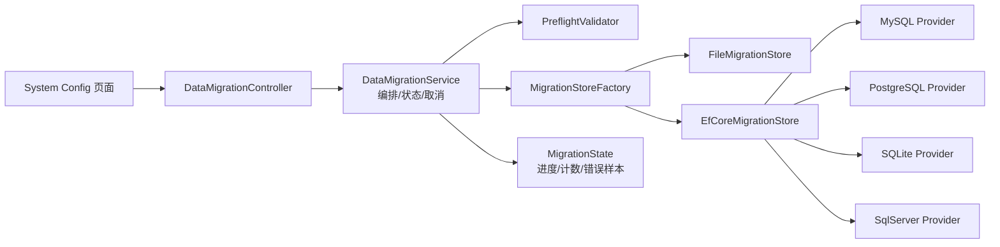

# 数据迁移多存储互转方案

> 目标：让 QuartzUI 的数据（作业、日志、设置、通知）支持 **文件、MySQL、PostgreSQL、SQLite、SQL Server** 五种存储之间任意方向互转，并保留现有「文件 → 数据库」迁移能力与 API 兼容性。

---

## 一、结论先行

1. 不再把「迁移」实现成 `FileJobStorage → 当前 IJobStorage` 的专用流程，而是抽象为对等的 **迁移源适配器（Source）→ 转换/校验 → 迁移目标适配器（Target）** 引擎。
2. 五种存储、任意两个不同存储之间共 **20 条有向路径**，全部由同一套引擎覆盖；新增存储只需新增一个适配器。
3. 支持三种写入模式：**Merge（默认，幂等）**、**Overwrite（按键更新）**、**Replace（清空后写入，强确认）**。
4. 支持四类数据独立勾选、迁移前预检（数量 / 冲突 / 结构）、迁移中进度与取消、迁移后校验。
5. 保留 `AddFileDataToDatabase()`、`TriggerMigration({force})` 的旧行为；旧调用方无需改代码。
6. 顺手修复现网隐患：强制重迁会因重建 `LogId` / `NotificationId` 产生重复数据；日志全量进内存；异常被吞导致状态误报。

---

## 二、现状盘点

### 2.1 现有实现

| 能力 | 位置 | 说明 |
|---|---|---|
| 迁移编排（旧） | `src/Chet.QuartzNet.UI/Services/FileDataMigrationService.cs` | 已改为兼容壳，委托 `StorageMigrationService` |
| 启动自动迁移 | `src/Chet.QuartzNet.UI/Extensions/ServiceCollectionExtensions.cs` 内 `FileDataMigrator` | 与上面逻辑重复约 300 行 |
| 对外 API | `src/Chet.QuartzNet.UI/Controllers/DataMigrationController.cs` | 只有查询状态、触发迁移两个接口 |
| DTO | `src/Chet.QuartzNet.Models/DTOs/DataMigrationDto.cs` | 步骤式状态 |
| 存储实现 | `FileJobStorage`、`EFCoreJobStorage` | 均实现 `IJobStorage` |
| Provider 选择 | `AddQuartzUI` 反射注册 | 启动时按 `StorageType + DatabaseProvider` 只注册一个 |

文件存储的物理结构：

| 数据 | 文件 |
|---|---|
| 作业 | `App_Data/QuartzJobs/jobs.json` |
| 日志 | `App_Data/QuartzJobs/logs.json` |
| 设置 | `App_Data/QuartzJobs/setting.json` |
| 通知 | `App_Data/QuartzJobs/notification.json` |

数据库表：`quartz_jobs`、`quartz_job_logs`、`quartz_settings`、`quartz_notifications`。

### 2.2 现有实现的限制

| # | 问题 | 影响 |
|---|---|---|
| 1 | 源固定为文件路径，目标固定为「当前运行时数据库」 | 无法 DB→File、DB→DB，也无法把数据迁到另一套数据库 |
| 2 | 目标必须是 `StorageType=Database` | 文件模式下甚至无法执行迁移 |
| 3 | 通过 `IJobStorage` 写入 | 目标只能是当前注册的存储，能力被运行时配置绑架 |
| 4 | `EFCoreJobStorage.AddJobLogsBatchAsync` 去重后又重新生成 `LogId` | **强制重迁会重复插入日志**（`EFCoreJobStorage.cs` 约 1472 行） |
| 5 | `AddNotificationsBatchAsync` 同样重建 `NotificationId` | **强制重迁会重复插入通知**（约 1592 行） |
| 6 | 日志/通知先分页读取再 `AddRange` 到内存列表 | 大数据量时内存占用高 |
| 7 | `IJobStorage` 批量方法内部 `catch` 后返回 0 | 迁移层无法区分「没数据」和「写失败」，状态可能误报成功 |
| 8 | 状态只存在内存 | 应用重启后丢失 |
| 9 | 无预检、无取消、无逐条错误、无迁移后校验 | 出问题只能看日志 |
| 10 | `AddJobsBatchAsync` 用 `JobName.Contains && JobGroup.Contains` 预查 | 条件过宽，大表上性能差（约 1386 行） |

### 2.3 关键约束

- 四个数据库 Provider 是独立 NuGet 包 + 独立 Migrations 程序集：
  - `Chet.QuartzNet.EFCore.MySQL`
  - `Chet.QuartzNet.EFCore.PostgreSQL`
  - `Chet.QuartzNet.EFCore.SQLite`
  - `Chet.QuartzNet.EFCore.SqlServer`
- 迁移到某个数据库，运行环境必须引用该 Provider 包；未引用时要能给出明确提示，而不是启动失败或静默跳过。
- `QuartzDbContext` 本身与 Provider 无关，可在运行时用不同 `DbContextOptions` 创建多个上下文实例。

---

## 三、目标与非目标

### 3.1 目标

- 5 种存储 × 4 个方向的任意互转（同类型不允许，防止自覆盖）。
- 源、目标都可显式选择；目标可以是「当前数据库」之外的数据库。
- 支持作业 / 日志 / 设置 / 通知按需勾选。
- 支持 Merge / Overwrite / Replace 三种模式。
- 迁移前可预检，迁移中可看进度、可取消，迁移后可校验。
- 大日志分页流式处理，不一次性全量进内存。
- 旧 API、旧配置、旧调用方式保持可用。

### 3.2 非目标

- 不做持续同步 / 双写 / CDC。
- 不做任意业务表的通用 ETL，只处理 QuartzUI 的四类数据。
- 不自动修改 `appsettings.json` 或热切换运行时存储；迁移完成后由用户改配置并重启。
- 不解决跨版本表结构演进（源库版本过旧时给出明确提示，见 6.5）。

---

## 四、总体架构



### 4.1 设计原则

1. **迁移与运行时存储解耦**：迁移不经过 `IJobStorage`，避免“目标必须是当前存储”的耦合。
2. **源与目标对等**：任何存储都实现同一套读写能力；文件也是“存储”，不是特例。
3. **流式分页**：按实体分页读、按批写、批批提交，内存占用与总量无关。
4. **幂等优先**：保留源端主键/业务键；同一批数据重跑不会产生重复。
5. **失败可见**：适配器抛异常，编排器记录并决定继续或中止；不再用 `0/false` 吞掉失败。
6. **安全默认值**：Replace 默认关闭；连接串默认只在服务端配置，UI 不落库、不写日志。

### 4.2 方案选型

| 方案 | 做法 | 结论 |
|---|---|---|
| A. 在现有 Service 上继续加分支 | 为每个方向写 if/else | 20 条路径，不可维护 |
| **B. Source/Target 适配器引擎** | 统一接口 + 工厂 + 编排器 | **推荐** |
| C. 引入外部 ETL | 依赖外部工具 | 部署成本高，与 UI 集成差 |

---

## 五、核心抽象设计

### 5.1 存储描述与枚举

```csharp
public enum MigrationStoreType
{
    File = 0,
    MySql = 1,
    PostgreSql = 2,
    SQLite = 3,
    SqlServer = 4,
}

public enum MigrationEntity
{
    Jobs = 0,
    Logs = 1,
    Settings = 2,
    Notifications = 3,
}

public enum MigrationWriteMode
{
    Merge = 0,      // 不存在则插入，存在则跳过（设置按键 Upsert）
    Overwrite = 1,  // 不存在则插入，存在则按主键/业务键更新
    Replace = 2,    // 先清空所选实体的目标数据，再写入
}

public sealed record MigrationStoreDescriptor(
    MigrationStoreType Type,
    string? FilePath = null,
    string? ConnectionString = null,
    string? ServerVersion = null,
    string? ProfileName = null);
```

### 5.2 统一适配器接口

放在 `Chet.QuartzNet.Core/Interfaces/IMigrationStore.cs`，只依赖 `Models` 实体，不依赖 EF Core。

```csharp
public interface IMigrationStore : IAsyncDisposable
{
    MigrationStoreDescriptor Descriptor { get; }

    /// <summary>连通性、版本、表/文件结构预检；失败抛异常</summary>
    Task ProbeAsync(bool asTarget, CancellationToken cancellationToken = default);

    /// <summary>仅目标使用：确保目标结构存在（文件=建目录，数据库=应用 Migrations）</summary>
    Task EnsureTargetSchemaAsync(CancellationToken cancellationToken = default);

    Task<long> CountAsync(MigrationEntity entity, CancellationToken cancellationToken = default);

    Task<MigrationPage<QuartzJobInfo>> ReadJobsAsync(int offset, int pageSize, CancellationToken ct);
    Task<MigrationPage<QuartzJobLog>> ReadLogsAsync(int offset, int pageSize, CancellationToken ct);
    Task<MigrationPage<QuartzSetting>> ReadSettingsAsync(int offset, int pageSize, CancellationToken ct);
    Task<MigrationPage<QuartzNotification>> ReadNotificationsAsync(int offset, int pageSize, CancellationToken ct);

    Task<WriteOutcome> WriteJobsAsync(IReadOnlyList<QuartzJobInfo> items, MigrationWriteMode mode, CancellationToken ct);
    Task<WriteOutcome> WriteLogsAsync(IReadOnlyList<QuartzJobLog> items, MigrationWriteMode mode, CancellationToken ct);
    Task<WriteOutcome> WriteSettingsAsync(IReadOnlyList<QuartzSetting> items, MigrationWriteMode mode, CancellationToken ct);
    Task<WriteOutcome> WriteNotificationsAsync(IReadOnlyList<QuartzNotification> items, MigrationWriteMode mode, CancellationToken ct);

    Task<long> ClearAsync(MigrationEntity entity, CancellationToken ct);
}
```

配套模型：

```csharp
public sealed class MigrationPage<T>
{
    public int Offset { get; init; }
    public int Total { get; init; }
    public IReadOnlyList<T> Items { get; init; } = Array.Empty<T>();
}

public sealed class WriteOutcome
{
    public int Inserted { get; init; }
    public int Updated { get; init; }
    public int Skipped { get; init; }
    public int Failed { get; init; }
    public List<MigrationRowError> Errors { get; init; } = new();
}
```

> 说明：这里刻意使用「每实体一组显式方法」而不是泛型 + `object`，避免迁移核心出现大量强制转换；实体只有四个，显式接口更易读、易测。

### 5.3 文件适配器 `FileMigrationStore`

位置：`src/Chet.QuartzNet.Core/Migration/FileMigrationStore.cs`

- 读取：复用 `FileJobStorage`（按目标路径构造 `IOptions<QuartzUIOptions>`），日志/通知用分页方法。
- 写入：
  - 新增 `FileMigrationWriter`，直接写四个 JSON 文件，序列化复用 `JsonSerializationConfig.JsonOptions()`，保证与 `FileJobStorage` 互相可读。
  - **原子写**：先写 `xxx.json.tmp`，`File.Move(tmp, final, overwrite: true)`，避免迁移中断留下半个文件。
  - Replace：写入前把目标目录整体备份到 `{targetPath}/Backup/migration_{yyyyMMdd_HHmmss}`。
  - 日志采用 `Utf8JsonWriter` 流式写数组：逐页读源、逐条写入临时文件，不把全量日志放内存。
  - Merge/Overwrite 到已有文件：先加载目标已有键集合（作业复合键、`LogId`、`Setting.Key`、`NotificationId`），再合并写回；文件日志量大时以 `HashSet<Guid>` 记录已存在 ID，内存可控。
- 文件名常量提升到 `FileJobStorage` 的 `public const`，避免两处硬编码不一致。

### 5.4 数据库适配器 `EfCoreMigrationStore`

位置：`src/Chet.QuartzNet.EFCore/Migration/EfCoreMigrationStore.cs`

- 直接创建 `QuartzDbContext`（不经过 `AddDbContext`，因为要同时存在多个不同 Provider 的上下文）。
- 读取：`AsNoTracking()` + 固定排序 + `Skip/Take`。
- 写入：按批 `AddRange` / 按键 `Update`；每批一个事务；每批后 `ChangeTracker.Clear()`，避免跟踪器无限增长。
- Replace 清空：分块删除（如每批 5000 行），避免一次性大事务锁表；SQLite 走 `DELETE` + WAL。
- 目标结构：`Database.MigrateAsync()`，Migrations 程序集由 Provider 工厂提供。
- 源结构：**不执行 Migrations**；只做版本预检（见 6.5）。

### 5.5 Provider 工厂（跨库关键）

在 `Chet.QuartzNet.EFCore` 定义：

```csharp
public interface IQuartzMigrationProvider
{
    MigrationStoreType StoreType { get; }
    string PackageName { get; }
    DbContextOptions<QuartzDbContext> CreateDbContextOptions(
        string connectionString,
        string? serverVersion);
}
```

四个 Provider 包各自新增一个约 30 行的实现：

| 项目 | 实现类 | 程序集名（已核实） |
|---|---|---|
| `Chet.QuartzNet.EFCore.MySql` | `MySqlMigrationProvider` | `Chet.QuartzNet.EFCore.MySQL` |
| `Chet.QuartzNet.EFCore.PostgreSql` | `PostgreSqlMigrationProvider` | `Chet.QuartzNet.EFCore.PostgreSQL` |
| `Chet.QuartzNet.EFCore.SQLite` | `SqliteMigrationProvider` | `Chet.QuartzNet.EFCore.SQLite` |
| `Chet.QuartzNet.EFCore.SqlServer` | `SqlServerMigrationProvider` | `Chet.QuartzNet.EFCore.SqlServer` |

工厂 `MigrationStoreFactory` 的解析顺序：

1. 已在 `AppDomain` 中加载的程序集里找 `IQuartzMigrationProvider` 实现；
2. 未加载则按已知程序集名 `Assembly.Load(name)`；
3. 都失败 → 返回明确错误：`未安装 Chet.QuartzNet.EFCore.MySQL 包，无法迁移到 MySQL`。

MySQL 细节：`ServerVersion` 优先级为「配置/请求传入 > `MySqlServerVersion.AutoDetect(connectionString)`」；自动探测失败时提示用户显式配置版本。
SQLite 细节：目标路径不存在时先 `Directory.CreateDirectory`；连接串建议附加 `Cache=Shared`，迁移期间单写者。
PostgreSQL 细节：沿用 `QuartzDbContext` 的 `timestamp without time zone` 处理，不做时区换算。

> 可选：提供聚合包 `Chet.QuartzNet.EFCore.All`（仅依赖四个 Provider，便于“开箱即用互转”）。若不提供，则用户按需引用目标 Provider 包，UI 会显示哪些 Provider 可用。

### 5.6 编排器 `StorageMigrationService`

位置：`src/Chet.QuartzNet.UI/Services/StorageMigrationService.cs`（新，代码/API 统一使用 `StorageMigration` 前缀，界面文案仍为「数据迁移」），保留旧 `FileDataMigrationService` 作为兼容壳（内部委托新服务）。

职责：

- 单例、进程内互斥（同一时间只允许一个迁移）。
- 持有 `CancellationTokenSource`、`MigrationState`。
- 预检 → 备份 → 建结构 → （Replace 确认）→ 逐实体迁移 → 校验 → 汇总。
- 不直接引用 `FileJobStorage` / `EFCoreJobStorage`，只通过 `IMigrationStore`。

---

## 六、数据映射与一致性规则

### 6.1 实体与键

| 实体 | 文件 | 表 | 去重/更新键 | ID 策略 |
|---|---|---|---|---|
| 作业 | `jobs.json` | `quartz_jobs` | `(JobName, JobGroup)` | 无独立 ID |
| 日志 | `logs.json` | `quartz_job_logs` | `LogId` | **保留源 `LogId`** |
| 设置 | `setting.json` | `quartz_settings` | `Key`（唯一索引） | 保留 `SettingId` |
| 通知 | `notification.json` | `quartz_notifications` | `NotificationId` | **保留源 `NotificationId`** |

> 这是修复重复数据的关键：迁移不得重新生成 `LogId` / `NotificationId` / `SettingId`。重跑时靠原 ID 去重，天然幂等。

### 6.2 写入模式语义

| 模式 | 作业 | 日志 | 设置 | 通知 |
|---|---|---|---|---|
| Merge | 键不存在则插入，存在则跳过 | ID 不存在则插入，存在跳过 | 键不存在则插入，存在跳过 | ID 不存在则插入，存在跳过 |
| Overwrite | 键存在则更新全部业务字段 | ID 存在则更新执行结果字段 | 按键 Upsert 并覆盖 | ID 存在则更新 |
| Replace | 清空后全量插入 | 清空后全量插入 | 清空后全量插入 | 清空后全量插入 |

Overwrite 更新作业时不改 `CreateTime`（保留目标首次创建时间），其余字段以源为准；日志视为不可变数据，`Merge` 与 `Overwrite` 对已存在日志都只跳过（避免迁移把线上日志改回旧状态），仅 `Replace` 会重写。

### 6.3 字段校验与转换

- 字符串：按 EF 配置校验长度（如 `JobName` 100、`Description` 500、`CronExpression` 200）。超长不静默截断，记录为失败行并给出字段名。
- 必填：`JobName`、`JobGroup`、`TriggerName`、`TriggerGroup`、`CronExpression`、`JobClassOrApi`、`Key`、`Value` 为空则失败。
- 枚举：数据库存 `int`，JSON 中 `JobTypeEnum` 为字符串（有 `JsonStringEnumConverter`），其余为数字；以实体反序列化结果为准，不手工解析。
- 时间：统一按“墙上时间”传递，不做 UTC 换算；`DateTimeKind.Unspecified` 原样写入。PostgreSQL 使用 `timestamp without time zone`；SQLite 以文本存储。
- Guid：统一小写 `D` 格式；SQLite 由 EF 以 TEXT 存储，跨库读写由 EF 负责。
- `JobData` / `ApiHeaders` / `ApiBody` / `Exception` 等长文本使用 `text` 类型（EF 配置已声明），迁移不改写内容。

### 6.4 跨库差异与坑位

| 项 | 说明 | 处理 |
|---|---|---|
| MySQL 索引长度 | `(JobName, JobGroup)` 各 100 字符，utf8mb4 下 800 字节，InnoDB 默认 3072 字节上限内 | 连接串必须 `CharSet=utf8mb4` |
| MySQL 批量性能 | 现有 Provider 配置 `MaxBatchSize(1)`，批量插入会退化为逐条 | 迁移上下文不启用该限制（单独构造 Options）；仍按 200~500 一批提交 |
| SQL Server 排序规则 | 大小写不敏感时，`Job`/`job` 可能冲突 | 预检阶段检测大小写键冲突并告警 |
| MySQL 排序规则 | 同上 | 同上 |
| PostgreSQL 时间 | `timestamp without time zone` | 已由 `QuartzDbContext` 处理 |
| SQLite 并发 | 迁移期间写锁 | WAL + `busy_timeout`；迁移时暂停业务写入 |
| SQLite 文件路径 | 目标库文件可能需要先建目录 | 适配器内 `Directory.CreateDirectory` |
| 文件写入原子性 | `FileJobStorage` 现有写入是 `FileMode.Create` 覆盖，非原子 | 迁移目标统一走临时文件 + `File.Move` 原子替换 |
| 文件读取一致性 | 业务进程正在写文件时可能读到半截 JSON | 迁移前提示维护窗口；源文件先做快照备份；读取失败明确报错 |

### 6.5 源库版本预检

数据库源不执行 `MigrateAsync`（避免改动生产库）。预检读取 `__EFMigrationsHistory`：

- 源库迁移记录落后于当前 Provider 包 → 直接失败并提示：
  `源数据库结构版本较旧（缺少列 xxx），请先用当前版本应用启动一次以完成升级，或勾选「允许升级源库结构」。`
- 提供开关 `AllowUpgradeSourceSchema`（默认 `false`），仅对明确允许的场景执行源库 Migrations。
- 文件源天然容忍旧字段（`System.Text.Json` 缺失属性取默认值）。

---

## 七、迁移执行流程

```text
1. ValidateRequest
   - 源/目标不能相同
   - 目标 Provider 是否已安装
   - 勾选实体非空
   - Replace 是否带确认标记
2. BuildStores（工厂创建 Source / Target）
3. Probe
   - 源：可读、版本、四类数据数量
   - 目标：可连接、结构状态、是否已有数据
4. Preview（仅预检时到此返回）
   - 每实体：源数量、目标已有数量、预计插入/更新/跳过、告警
5. Backup
   - 文件源：复制到 Backup/migration_{timestamp}
   - 数据库源：不自动备份，提示用户自行备份
6. EnsureTargetSchema
   - 数据库：应用目标 Provider Migrations
   - 文件：创建目录
7. Replace 清空（仅 Replace 模式，按勾选实体）
8. 逐实体迁移，顺序：设置 → 作业 → 通知 → 日志
   - 分页读取 → 校验/转换 → 批量写入 → 汇总计数
   - 每批检查取消令牌
9. Verify
   - 数量对比
   - 抽样对比（默认各实体取首/中/尾 20 条按键比对）
   - 冲突/失败列表
10. Complete / Failed / Cancelled
```

顺序理由：设置/作业体量小，先验证链路；日志最大放最后，失败时前面的数据已可用。

### 7.1 进度与状态

`MigrationState`（内存，线程安全）：

```csharp
public sealed class MigrationState
{
    public string MigrationId { get; init; }
    public MigrationStoreDescriptor Source { get; init; }
    public MigrationStoreDescriptor Target { get; init; }
    public MigrationWriteMode Mode { get; init; }
    public MigrationStage Stage { get; set; }
    public string? CurrentEntity { get; set; }
    public long Processed { get; set; }
    public long Total { get; set; }
    public int ProgressPercent { get; set; }
    public DateTime? StartTime { get; set; }
    public DateTime? EndTime { get; set; }
    public bool IsRunning { get; set; }
    public bool IsCancelled { get; set; }
    public bool IsCompleted { get; set; }
    public bool IsSuccess { get; set; }
    public string? ErrorMessage { get; set; }
    public List<MigrationEntityState> Entities { get; set; } = new();
    public List<MigrationRowError> ErrorSamples { get; set; } = new();
}
```

- 每处理一批更新一次状态，不是每行加锁。
- 错误样本最多保留 20 条（实体、键、字段、消息），避免状态膨胀。
- 可选增强：把最后一次迁移结果写 `App_Data/QuartzJobs/migration-history.json`，重启后可查看（非必需，建议做）。

### 7.2 取消与失败语义

- 取消：请求 `CancelMigration`，编排器在当前批次结束后停止；状态置 `Cancelled`，保留已完成计数。
- 失败：适配器抛出异常 → 记录批次错误；`ContinueOnError=true` 时跳过该批继续，否则立即中止。
- 目标可能处于“部分写入”状态；由于采用键去重 + 保留 ID：
  - Merge / Overwrite 可直接重跑；
  - Replace 需整体重跑（先清空再写入，天然可重入）。

### 7.3 并发与写入窗口

- 迁移前建议停止业务写入（尤其是文件源，避免读到半截 JSON）。
- 可选开关 `PauseSchedulerDuringMigration`：迁移期间暂停 Quartz 调度器（只暂停触发，不停止宿主），完成后恢复；默认关闭，避免改变现有行为。

---

## 八、API 设计

### 8.1 接口清单

| 方法 | 路径 | 说明 |
|---|---|---|
| GET | `/api/quartz/GetMigrationOptions` | 当前存储、已安装 Provider、可选文件源、服务端迁移配置档 |
| POST | `/api/quartz/PreviewMigration` | 预检：数量、冲突、告警，不写任何数据 |
| POST | `/api/quartz/TriggerMigration` | 触发迁移（扩展请求体；旧 `{force}` 仍可用） |
| GET | `/api/quartz/GetMigrationStatus` | 进度、逐步计数、错误样本、方向 |
| POST | `/api/quartz/CancelMigration` | 取消当前迁移 |

所有接口沿用 `[Authorize(Policy = "QuartzUIPolicy")]`；同时提供 `StorageMigration/*` 同义路由（`GetStatus`、`GetOptions`、`Preview`、`Trigger`、`Cancel`）。

### 8.2 触发请求

```json
{
  "source": {
    "type": "File",
    "filePath": "App_Data/QuartzJobs"
  },
  "target": {
    "type": "PostgreSql",
    "profileName": "pg-dev"
  },
  "entities": ["jobs", "logs", "settings", "notifications"],
  "mode": "Merge",
  "continueOnError": false,
  "confirmReplace": false,
  "pauseScheduler": false,
  "force": false
}
```

兼容规则：

- 不传 `source` / `target` → 等价旧行为：源 = `QuartzUI.FileStoragePath`，目标 = 当前数据库（要求 `StorageType=Database`）。
- 只传 `force=true` → 允许重复执行；由于新引擎幂等，不再产生重复日志/通知。
- `mode=Replace` 必须显式 `confirmReplace=true`，且服务端配置 `Migration.AllowReplace=true`，否则拒绝。

### 8.3 预检响应

```json
{
  "canRun": true,
  "source": "File(App_Data/QuartzJobs)",
  "target": "PostgreSql(pg-dev)",
  "entities": [
    { "entity": "jobs", "sourceCount": 12, "targetCount": 3, "willInsert": 9, "willUpdate": 0, "willSkip": 3 },
    { "entity": "logs", "sourceCount": 10234, "targetCount": 5000, "willInsert": 5234, "willUpdate": 0, "willSkip": 5000 },
    { "entity": "settings", "sourceCount": 8, "targetCount": 8, "willInsert": 0, "willUpdate": 8, "willSkip": 0 },
    { "entity": "notifications", "sourceCount": 25, "targetCount": 25, "willInsert": 0, "willUpdate": 0, "willSkip": 25 }
  ],
  "warnings": [
    "源日志 5234 条，预计耗时较长，建议在维护窗口执行",
    "目标数据库已有数据，Replace 模式会先清空所选实体"
  ]
}
```

### 8.4 状态响应（在现有 DTO 上增量扩展）

保留现有字段：`isRunning`、`progressPercent`、`steps[]`、`startTime`、`endTime`、`durationMs`、`isCompleted`、`isSuccess`、`errorMessage`、`fileStoragePath`、`storageType`。

新增字段：

```csharp
public string MigrationId { get; set; }
public string SourceDisplay { get; set; }
public string TargetDisplay { get; set; }
public string Mode { get; set; }
public string Stage { get; set; }          // Validate/Probe/Backup/EnsureSchema/Migrate/Verify/Done
public string? CurrentEntity { get; set; }
public long Processed { get; set; }
public long Total { get; set; }
public bool IsCancelled { get; set; }
public List<MigrationEntityState> Entities { get; set; }
public List<MigrationRowError> ErrorSamples { get; set; }
```

---

## 九、配置设计

```json
{
  "QuartzUI": {
    "StorageType": "File",
    "DatabaseProvider": "PostgreSql",
    "Migration": {
      "Profiles": {
        "pg-dev": {
          "Provider": "PostgreSql",
          "ConnectionString": "Host=127.0.0.1;Port=5432;Database=quartz_ui;Username=postgres;Password=***"
        },
        "mysql-dev": {
          "Provider": "MySql",
          "ConnectionString": "Server=127.0.0.1;Port=3306;Database=quartz_ui;User=root;Password=***;CharSet=utf8mb4",
          "ServerVersion": "8.0.36"
        },
        "sqlite-dev": {
          "Provider": "SQLite",
          "ConnectionString": "Data Source=App_Data/quartz-ui.db"
        },
        "sqlserver-dev": {
          "Provider": "SqlServer",
          "ConnectionString": "Server=127.0.0.1;Database=quartz_ui;User Id=sa;Password=***;TrustServerCertificate=True"
        }
      },
      "FileSources": [
        { "Name": "默认文件存储", "Path": "App_Data/QuartzJobs" }
      ],
      "BatchSize": 500,
      "ContinueOnError": false,
      "AllowReplace": false,
      "AllowAdHocConnectionString": false,
      "VerifyMode": "CountAndSample",
      "MaxErrorSamples": 20
    }
  }
}
```

安全约定：

- 配置档的连接串**不下发前端**，`GetMigrationOptions` 只返回 `name / provider / 是否配置密码`。
- 默认禁止前端直接提交连接串（`AllowAdHocConnectionString=false`）；如开启，连接串仅在请求内存中使用，不落盘、不写日志、状态里脱敏。
- 迁移日志只打印「目标类型 + 主机/库名」，不打印完整连接串。

---

## 十、代码改造清单

### 10.1 后端

| 项目 | 文件 | 改动 |
|---|---|---|
| Core | `Interfaces/IMigrationStore.cs` | **新增** 适配器接口 |
| Core | `Migration/MigrationModels.cs` | **新增** 枚举、描述符、分页、写入结果 |
| Core | `Migration/FileMigrationStore.cs` | **新增** 文件源/目标实现 |
| Core | `Migration/FileMigrationWriter.cs` | **新增** 原子写、流式日志写、目标备份 |
| Core | `Services/FileJobStorage.cs` | 文件名提取为 `public const`，供迁移复用 |
| EFCore | `Migration/IQuartzMigrationProvider.cs` | **新增** Provider 工厂接口 |
| EFCore | `Migration/EfCoreMigrationStore.cs` | **新增** 数据库源/目标实现 |
| EFCore | `Migration/MigrationStoreFactory.cs` | **新增** 反射解析 Provider、构造存储 |
| EFCore | `Services/EFCoreJobStorage.cs` | 修复批量日志/通知重建 ID；可选：`AddJobsBatchAsync` 预查条件改为精确键 |
| EFCore.MySql | `Migration/MySqlMigrationProvider.cs` | **新增** |
| EFCore.PostgreSql | `Migration/PostgreSqlMigrationProvider.cs` | **新增** |
| EFCore.SQLite | `Migration/SqliteMigrationProvider.cs` | **新增** |
| EFCore.SqlServer | `Migration/SqlServerMigrationProvider.cs` | **新增** |
| Models | `DTOs/DataMigrationDto.cs` | 扩展请求/预检/状态 DTO，保留旧字段 |
| UI | `Services/DataMigrationService.cs` | **新增** 编排器（预检/执行/状态/取消/校验） |
| UI | `Services/FileDataMigrationService.cs` | 改为兼容壳，内部委托新服务 |
| UI | `Controllers/DataMigrationController.cs` | 新增 options/preview/cancel，扩展 trigger |
| UI | `Extensions/ServiceCollectionExtensions.cs` | 注册新服务与工厂；`FileDataMigrator` 改为调用新服务 |
| UI | `Extensions/ServiceCollectionExtensions.cs` | 可选：`AddQuartzUIMigrationProviders()` 显式注册 Provider（非必需，工厂可反射发现） |

### 10.2 前端

| 文件 | 改动 |
|---|---|
| `src/Chet.QuartzNet.Web/apps/web-antd/src/api/quartz/system-config.ts` | 新增 options/preview/cancel 类型与请求 |
| `src/Chet.QuartzNet.Web/apps/web-antd/src/views/quartz/system-config.vue` | 迁移面板升级为「源/目标/范围/模式/预检/进度/结果」 |
| `src/Chet.QuartzNet.Web/apps/web-antd/src/locales/langs/zh-CN/page.json` | 新增文案 |
| `src/Chet.QuartzNet.Web/apps/web-antd/src/locales/langs/en-US/page.json` | 新增文案 |

UI 交互建议：

1. 源选择：文件路径下拉（服务端已配置文件源）或数据库配置档；默认源 = 当前文件路径。
2. 目标选择：数据库配置档；默认目标 = 当前数据库（若当前是数据库模式）。
3. 数据范围：四个复选框，默认全选。
4. 模式：Merge（推荐）/ Overwrite / Replace；Replace 需输入确认词。
5. 「预检」按钮先看数量与冲突；预检通过后才允许「开始迁移」。
6. 进度区展示：当前实体、已处理/总数、成功/更新/跳过/失败、当前阶段。
7. 完成后展示校验结果和错误样本；失败时提供「重跑（Merge）」按钮。

### 10.3 测试

建议新增 `test/Chet.QuartzNet.Migration.Test`（xUnit）：

- 单元：键去重、三种模式、ID 保留、字段校验、文件原子写、取消。
- 集成：
  - File ↔ SQLite：无需外部依赖，覆盖读写双向。
  - MySQL / PostgreSQL / SQL Server：Testcontainers（可选，CI 有 Docker 时启用）。
- 矩阵验收：5 源 × 4 目标 = 20 条路径，每条至少跑一次 Merge；Replace/Overwrite 各抽 2 条路径覆盖。

---

## 十一、兼容性与发布影响

| 项 | 处理 |
|---|---|
| `AddFileDataToDatabase()` | 保留；内部改为调用新编排器（File → 当前 DB，Merge） |
| `TriggerMigration({force})` | 保留；请求体新增字段全部可选 |
| `GetMigrationStatus` | 保留旧字段，仅追加新字段，旧前端不受影响 |
| `FileDataMigrationService` | 保留类名与单例注册，内部委托新服务（可选标记 `[Obsolete]`） |
| 现有 Provider 包 | 不需改调用方式；新增 Provider 工厂类不影响现有注册 |
| 未安装目标 Provider 包 | 不报启动错误；运行时返回明确“包未安装”提示 |
| 迁移完成后 | 不自动改配置；返回目标连接串模板与 `StorageType/DatabaseProvider` 建议值 |

---

## 十二、风险与缓解

| 风险 | 影响 | 缓解 |
|---|---|---|
| 源文件正在写入 | 读到半截 JSON | 维护窗口 + 迁移前快照备份 + 读取失败明确报错 |
| 目标库已有业务写入 | 键冲突/覆盖 | 预检展示冲突；默认 Merge；Replace 强确认 |
| 大日志量 | 内存/耗时/锁表 | 分页流式 + 批事务 + 可取消 + 日志最后迁 |
| 源库版本旧 | 缺列导致查询失败 | 迁移记录预检；给出升级指引；可选允许升级源库 |
| 连接串泄露 | 安全风险 | 默认配置档 + 不下发前端 + 脱敏日志 |
| MySQL 批量退化 | 迁移慢 | 迁移上下文关闭 `MaxBatchSize(1)` |
| SQLite 锁 | 写入失败 | WAL + busy_timeout + 单写者 |
| 中途失败 | 目标部分数据 | 键去重 + 保留 ID，Merge 可直接重跑 |
| 时间字段时区 | 时间偏移 | 统一墙上时间，不做换算；PostgreSQL 用无时区类型 |
| 大小写排序规则差异 | 键冲突 | 预检大小写冲突告警 |

---

## 十三、实施阶段

### Phase 1：迁移内核（File ↔ DB 双向）

- 新增 `IMigrationStore`、`FileMigrationStore`、`EfCoreMigrationStore`、`MigrationStoreFactory`。
- 新增 `DataMigrationService`，实现预检、Merge/Overwrite/Replace、进度、取消、校验。
- 旧 `TriggerMigration` 与 `AddFileDataToDatabase` 接到新内核。
- 验收：File ↔ SQLite 双向；旧接口行为不回归；强制重迁不产生重复日志/通知。

### Phase 2：跨数据库互转

- 四个 Provider 包新增 `IQuartzMigrationProvider` 实现。
- 工厂支持未加载程序集按名加载与缺失提示。
- 处理 MySQL ServerVersion、SQLite 目录、PostgreSQL 时间类型、SQL Server 连接参数。
- 验收：MySQL / PostgreSQL / SQL Server / SQLite 两两互转（12 条 DB→DB 路径）各跑通 Merge。

### Phase 3：预检与 UI

- `GetMigrationOptions`、`PreviewMigration`、`CancelMigration`。
- 前端迁移面板升级；中英文案补齐。
- 验收：预检数量与实际迁移一致；Replace 二次确认；取消后状态正确。

### Phase 4：校验、测试与文档

- 迁移后数量 + 抽样校验；错误样本展示。
- 测试项目与 20 条路径矩阵。
- README / 博客补充「多存储互转」章节。

---

## 十四、验收标准

1. 20 条有向路径（5 源 × 4 目标）均可完成 Merge 迁移，数量一致。
2. 同一批数据连续执行两次 Merge，作业/日志/设置/通知数量不增加。
3. Replace 模式在目标已有数据时可正确清空并重建，且迁移前有备份（文件目标）。
4. 迁移过程中取消，状态为 `Cancelled`，目标数据可通过重跑 Merge 修复。
5. 未安装目标 Provider 包时，UI 禁用该目标并显示缺失包名。
6. 旧调用 `AddFileDataToDatabase()` 与 `TriggerMigration({force:true})` 行为正常。
7. 迁移状态包含方向、模式、阶段、逐实体计数与错误样本；旧前端字段仍可读。

---

## 十五、待确认事项（附推荐默认值）

| # | 决策 | 推荐默认 |
|---|---|---|
| 1 | 目标数据库连接串来源 | **服务端 `QuartzUI:Migration:Profiles` 配置档**，默认不允许前端直传；如你需要“填表即迁”，再打开 `AllowAdHocConnectionString` |
| 2 | 是否允许 Replace | **默认关闭**，需要显式开启并二次确认；适合测试环境 |
| 3 | 迁移完成后是否自动切换存储 | **不自动**；返回配置片段，由用户改 `appsettings.json` 后重启 |
| 4 | 是否提供 `Chet.QuartzNet.EFCore.All` 聚合包 | 可选；不提供则按需引用目标 Provider 包，UI 显示可用性 |
| 5 | 是否修复 `IJobStorage` 批量方法的 ID 重建问题 | **是**（独立小修复，避免其他调用方踩坑） |
| 6 | 迁移期间是否暂停调度器 | **默认不暂停**，提供开关 `pauseScheduler` |

---

## 十六、关键代码位置索引

| 主题 | 位置 |
|---|---|
| 现有迁移编排 | `src/Chet.QuartzNet.UI/Services/FileDataMigrationService.cs` |
| 重复的启动迁移 | `src/Chet.QuartzNet.UI/Extensions/ServiceCollectionExtensions.cs`（`FileDataMigrator`） |
| 迁移 API | `src/Chet.QuartzNet.UI/Controllers/DataMigrationController.cs` |
| 迁移 DTO | `src/Chet.QuartzNet.Models/DTOs/DataMigrationDto.cs` |
| 存储接口 | `src/Chet.QuartzNet.Core/Interfaces/IJobStorage.cs` |
| 文件存储 | `src/Chet.QuartzNet.Core/Services/FileJobStorage.cs` |
| EF 存储 | `src/Chet.QuartzNet.EFCore/Services/EFCoreJobStorage.cs` |
| DbContext / 表映射 | `src/Chet.QuartzNet.EFCore/Data/QuartzDbContext.cs` |
| Provider 反射注册 | `src/Chet.QuartzNet.UI/Extensions/ServiceCollectionExtensions.cs`（`RegisterDatabaseStorage`） |
| Provider 注册示例 | `src/Chet.QuartzNet.EFCore.MySql/Extensions/ServiceCollectionExtensions.cs` |
| 前端迁移面板 | `src/Chet.QuartzNet.Web/apps/web-antd/src/views/quartz/system-config.vue` |
| 前端迁移 API | `src/Chet.QuartzNet.Web/apps/web-antd/src/api/quartz/system-config.ts` |
