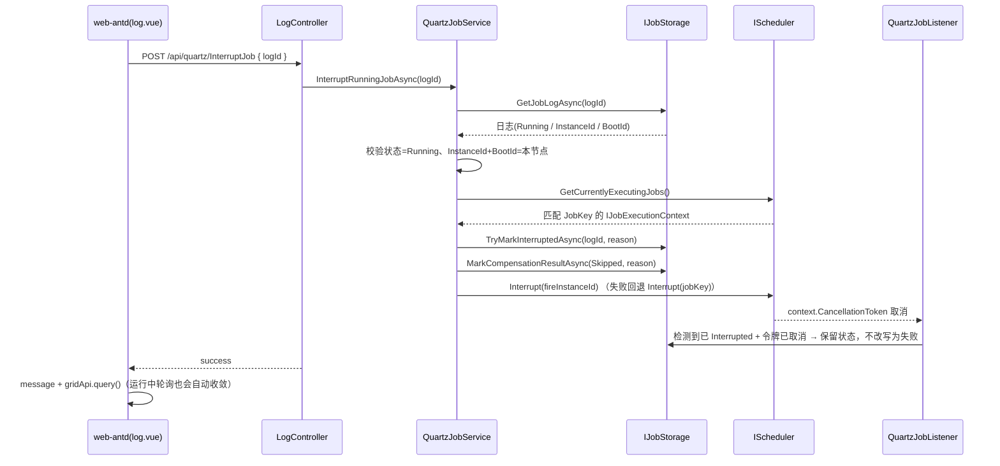

# 运行中作业手动中断 · 实现方案（方案 B：零迁移）

> 范围：`Chet.QuartzNet.Core` / `Chet.QuartzNet.Models` / `Chet.QuartzNet.UI` / `web-antd`。
> 结论先行：**术语统一为「中断」，不新增日志状态值、不新增表字段、不加操作人**。手动中断与不可预期中断（进程崩溃、停机超时）通过 `SkipReason` 的固定前缀 `【手动中断】` 做轻量标记，**能区分开即可**，仅用于展示口径，不做为 SQL 过滤依据。将来若「中断次数」「手动中断率」进入统计，再升级为独立字段。

---

## 一、为什么复用 `Interrupted` 而不新增状态

| 维度 | 不可预期中断 | 手动中断（本方案） |
|---|---|---|
| 触发者 | 进程崩溃 / 强杀 / 停机超时 / 排水超时 | 用户在日志页点击「中断作业」 |
| `LogStatus` | `Interrupted` | `Interrupted`（**同一个值**） |
| 补偿状态 | `Pending` → 下次启动按策略自动补偿 | `Skipped`（绝不自动补偿） |
| `SkipReason` | 空，或策略跳过原因（如「已有更新的中断记录」） | `【手动中断】用户手动中断作业` |
| 是否可手动重跑 | 可以（`compensationStatus != Triggered`） | 可以（同上） |

复用同一个状态的理由：

1. 前端状态列、筛选、统计口径都不用动，`statusInterrupted = "中断"` 直接可用。
2. 语义上手动中断本就是中断的一种，硬造 `Cancelled` 会让 analytics、清理策略、通知判定全部要补分支。
3. 真正的业务硬约束只有一条 —— **自动补偿的取舍**，它已经由 `CompensationStatus` 完整表达（`RecoveryCoordinator` 只挑 `Interrupted + Pending`）。

不记录操作人：系统只有 admin 一个账号，`TriggeredBy` 类字段没有信息量；`SkipReason` 里写死「用户手动中断作业」即可。

> 注意：`CompensationStatus = Skipped` 本身不能当「手动中断」判据 —— 它还有两个非人工来源：「已有更新的中断记录」（`RecoveryCoordinator.cs` L422-428）与策略跳过（L461-469）。所以必须叠加 `SkipReason` 前缀。

---

## 二、执行链路（时序）



关键顺序：**先标记、后中断**。中断会让作业立刻抛 `OperationCanceledException`，若监听器抢先收尾会写成「失败」；而 `QuartzJobListener` L147-165 对「已标记 `Interrupted` + 令牌已取消」的记录会保留中断状态。

---

## 三、后端改动

### 3.1 接口：`IQuartzJobService`

```csharp
/// <summary>
/// 中断一条运行中日志对应的执行实例（仅当前节点、协作式取消）
/// </summary>
Task<ApiResponseDto<bool>> InterruptRunningJobAsync(
    Guid logId,
    CancellationToken cancellationToken = default
);
```

### 3.2 实现：`QuartzJobService`

```csharp
/// <summary>手动中断在 SkipReason 中的固定前缀，用于与不可预期中断区分（仅展示用）</summary>
internal const string ManualInterruptPrefix = "【手动中断】";

public async Task<ApiResponseDto<bool>> InterruptRunningJobAsync(
    Guid logId, CancellationToken cancellationToken = default)
{
    try
    {
        var log = await _jobStorage.GetJobLogAsync(logId, cancellationToken);
        if (log == null)
            return ApiResponseDto<bool>.ErrorResponse("日志不存在", "LOG_NOT_FOUND");
        if (log.Status != LogStatus.Running)
            return ApiResponseDto<bool>.ErrorResponse("只有运行中的作业可以中断", "LOG_NOT_RUNNING");

        // 停机/重启后残留的 Running 记录，本进程里并不存在这个执行
        if (log.InstanceId != _runtimeInstance.InstanceId
            || (log.BootId.HasValue && log.BootId != _runtimeInstance.BootId))
            return ApiResponseDto<bool>.ErrorResponse(
                "该执行不在当前节点，或已随进程重启结束，无法中断", "LOG_NOT_ON_THIS_NODE");

        if (!IsSchedulerAvailable)
            return ApiResponseDto<bool>.ErrorResponse("调度器已停止，无法中断作业", "SCHEDULER_NOT_RUNNING");

        var jobKey = new JobKey(log.JobName, log.JobGroup);
        // 同一 JobKey 允许并发时，按 FireTime 找最接近的一条，精确到 fireInstanceId，避免误杀其它实例
        var target = (await Scheduler.GetCurrentlyExecutingJobs(cancellationToken))
            .Where(c => c.JobDetail.Key.Equals(jobKey))
            .OrderBy(c => Math.Abs((c.FireTimeUtc.LocalDateTime - log.StartTime).TotalMilliseconds))
            .FirstOrDefault();

        if (target == null)
            return ApiResponseDto<bool>.ErrorResponse("未找到正在执行的实例，可能已结束", "EXECUTION_NOT_FOUND");

        const string reason = ManualInterruptPrefix + "用户手动中断作业";

        // ① 先标记：中断会让作业立刻抛取消异常，若监听器抢先写入就会被改成「失败」
        if (!await _jobStorage.TryMarkInterruptedAsync(
                logId, _runtimeInstance.InstanceId, DateTime.Now, reason, cancellationToken))
            return ApiResponseDto<bool>.ErrorResponse("作业已结束，无法中断", "EXECUTION_FINISHED");

        // ② TryMarkInterrupted 会把补偿状态置为 Pending，手动中断不应进入自动补偿
        await _jobStorage.MarkCompensationResultAsync(
            logId, CompensationStatus.Skipped, null, reason, cancellationToken);

        // ③ 再中断：精确到本次执行，失败再回退到 JobKey
        var interrupted = await Scheduler.Interrupt(target.FireInstanceId, cancellationToken)
                          || await Scheduler.Interrupt(jobKey, cancellationToken);

        _logger.LogSuccess("中断作业", $"{log.JobGroup}.{log.JobName}, 日志: {logId}");
        return interrupted
            ? ApiResponseDto<bool>.SuccessResponse(true, "已请求中断作业")
            : ApiResponseDto<bool>.ErrorResponse("作业已结束，无法中断", "EXECUTION_FINISHED");
    }
    catch (Exception ex)
    {
        _logger.LogFailure("中断作业", ex);
        return ApiResponseDto<bool>.ErrorResponse($"中断作业失败: {ex.Message}");
    }
}
```

要点：

- `TryMarkInterruptedAsync` 只在 `Status == Running` 时原子成功（`EFCoreJobStorage.cs` L938-952），天然防重复点击。
- 它会把 `reason` 写进日志 `Message`，列表与详情「执行信息」即可看到「用户手动中断作业」。
- `MarkCompensationResultAsync` 写 `SkipReason = reason`，这是本方案唯一的新增信息载体。
- 若作业在「标记后、中断前」自己跑完且成功，监听器会按真实结果覆盖（`executionException == null` 不满足保留条件），自我纠正，无需回滚。

### 3.3 DTO 与 Controller

`src\Chet.QuartzNet.Models\DTOs\RecoveryDto.cs`，与 `RerunInterruptedLogRequestDto` 并列：

```csharp
public class InterruptRunningLogRequestDto
{
    public Guid LogId { get; set; }
}
```

`src\Chet.QuartzNet.UI\Controllers\LogController.cs`：

```csharp
/// <summary>
/// 中断一条运行中的作业日志
/// </summary>
[HttpPost("InterruptJob")]
public async Task<ActionResult<ApiResponseDto<bool>>> InterruptJob(
    [FromBody] InterruptRunningLogRequestDto request,
    CancellationToken cancellationToken = default)
{
    var result = await _jobService.InterruptRunningJobAsync(request.LogId, cancellationToken);
    if (!result.Success)
        _logger.LogWarn("中断作业", $"失败, 原因: {result.Message}, 错误码: {result.ErrorCode}");
    return Ok(result);
}
```

`LogController` 已有 `[Authorize(Policy = "QuartzUIPolicy")]`，无需额外鉴权。

---

## 四、前端改动

### 4.1 `api/quartz/log.ts`

```ts
/** 中断一条运行中日志对应的执行实例 */
export async function interruptRunningLog(
  logId: string,
): Promise<ApiResponse<boolean>> {
  return requestClient.post('/api/quartz/InterruptJob', { logId });
}

/** 手动中断标记：SkipReason 固定前缀，后端不可预期中断不会带此前缀 */
export const MANUAL_INTERRUPT_PREFIX = '【手动中断】';

export const isManualInterrupt = (log: LogResponseDto) =>
  log.status === LogStatusEnum.INTERRUPTED &&
  !!log.skipReason?.startsWith(MANUAL_INTERRUPT_PREFIX);

/** 展示用：裁掉前缀 */
export const manualInterruptText = (reason?: string | null) =>
  reason?.startsWith(MANUAL_INTERRUPT_PREFIX)
    ? reason.slice(MANUAL_INTERRUPT_PREFIX.length)
    : reason;
```

### 4.2 `views/quartz/log.vue`

沿用现有 `rerunningIds` / `handleRerun` 模式（L107、L731-767）：

```ts
const interruptingIds = ref<Set<string>>(new Set());
const isInterrupting = (logId: string) => interruptingIds.value.has(logId);

const handleInterrupt = (row: LogResponseDto) => {
  Modal.confirm({
    title: $t('page.quartz.logPage.confirmInterrupt'),
    content: `${row.jobName} · ${row.jobGroup}\n${$t('page.quartz.logPage.interruptWarning')}`,
    okText: $t('page.quartz.logPage.interruptOk'),
    okType: 'danger',
    cancelText: $t('page.quartz.logPage.cancel'),
    onOk: async () => {
      const next = new Set(interruptingIds.value);
      next.add(row.logId);
      interruptingIds.value = next;
      try {
        const res = await interruptRunningLog(row.logId);
        res.success
          ? message.success(res.message || $t('page.quartz.logPage.interruptSubmitted'))
          : message.warning(res.message || $t('page.quartz.logPage.interruptFailed'));
        await gridApi.query();
        await refreshDetailIfNeeded(row.logId);
      } catch (error: any) {
        message.error(error?.message || $t('page.quartz.logPage.interruptFailed'));
      } finally {
        const cur = new Set(interruptingIds.value);
        cur.delete(row.logId);
        interruptingIds.value = cur;
      }
    },
  });
};
```

操作列（`#action`，L1038-1062）在详情图标后追加，仅运行中显示：

```vue
<Tooltip
  v-if="row.status === LogStatusEnum.RUNNING"
  :title="isInterrupting(row.logId)
    ? $t('page.quartz.logPage.interrupting')
    : $t('page.quartz.logPage.interrupt')"
  placement="topRight"
>
  <!-- 用 vxe 字体图标：与详情图标同一 em 盒，大小天然一致；描边样式避免实心块过重 -->
  <i
    class="vxe-icon-no-drop px-1"
    :style="{ color: 'hsl(var(--destructive))' }"
    :class="isInterrupting(row.logId)
      ? 'cursor-not-allowed opacity-50'
      : 'cursor-pointer hover:opacity-80'"
    @click="!isInterrupting(row.logId) && handleInterrupt(row)"
  ></i>
</Tooltip>
```

`action` 列宽从 110 调到 130（L247）。运行中行每 5 秒轮询（L804-838）会自动收敛，无需额外逻辑。

### 4.3 展示口径

| 位置 | 规则 |
|---|---|
| 状态列 Tag | 保持 `中断`（`statusInterrupted`），手动中断不换词、不换色 |
| 状态 Tooltip | `interruptTip(row)`：`isManualInterrupt(row)` 时显示「手动中断」，否则「异常中断」 |
| 详情「恢复信息」 | 新增「中断方式」行（`interruptModeText`）；「跳过原因」用 `manualInterruptText` 裁掉前缀后展示。`compensationStatus === 'Triggered'` 时跳过原因已被重跑覆盖，不再猜中断方式 |
| 筛选 | 不新增；「仅看异常」维持 `Error + Interrupted`（手动中断也会被纳入，可接受） |

### 4.4 i18n（`page.quartz.logPage`）

| key | zh-CN | en-US |
|---|---|---|
| `interrupt` | 中断作业 | Interrupt job |
| `confirmInterrupt` | 确认中断作业 | Confirm interruption |
| `interruptWarning` | 将立即中断本次执行，已产生的外部副作用不会回滚；该记录标记为中断且不自动补偿。 | The current run will be interrupted immediately. External side effects are not rolled back and no automatic compensation follows. |
| `interruptOk` | 确认中断 | Interrupt |
| `interruptSubmitted` | 已请求中断作业 | Interruption requested |
| `interruptFailed` | 中断作业失败 | Failed to interrupt job |
| `interrupting` | 正在中断… | Interrupting... |
| `interruptManual` | 手动中断 | Manual interruption |
| `interruptUnexpected` | 异常中断 | Unexpected interruption |
| `interruptMode` | 中断方式 | Interruption mode |

`statusInterrupted` 保持「中断」，勿改成「已终止」。

---

## 五、已知取舍与边界

1. **协作式取消**：`Scheduler.Interrupt` 只是取消 `context.CancellationToken`（Quartz 3.15.1 官方 XML 文档 L3496-3502），不会 Abort 线程。API 作业已把令牌链接进 HTTP 请求（`ApiJob.cs` L176-183），可立即中断；DLL 自定义作业必须自己观察令牌，否则会继续跑完，最终状态被监听器覆盖成成功/失败。UI 提示需保留「不会强制杀线程」的隐含语义。
2. **仅本节点生效**：`Interrupt` 不跨节点。当前 `UseInMemoryStore` 单进程调度，用 `InstanceId + BootId` 校验即可；将来多实例需要按 `InstanceId` 路由或引入广播。
3. **前缀是文本约定**：不能做 SQL 过滤，统计只能 `LIKE`。属于本方案明确的取舍 —— 「能区分开来就行」。
4. **前缀会被清空**：用户后续对这条中断记录点「重新执行」成功后，`MarkCompensationResultAsync(Triggered, ..., null)` 会把 `SkipReason` 置空（`EFCoreJobStorage.cs` L1013-1015）。此时记录已是「已补偿重跑」，展示退回默认「中断」即可，无需处理。
5. **时长精度**：`TryMarkInterruptedAsync` 用 `HeartbeatTime ?? StartTime` 作为结束时间，心跳间隔内会少算几秒，可接受。
6. **不要用 `PauseJob` / `DeleteJob` 替代**：前者只阻止下次触发，后者会删掉作业定义与日志。

### 升级路径（将来需要统计/筛选时）

给 `QuartzJobLog` 增加 `InterruptionSource`（`None / Unexpected / Manual`）+ 4 个 EF Provider 各一份迁移；`TryMarkInterruptedAsync` 加参数，`DrainCoordinator` / `RecoveryCoordinator` 传 `Unexpected`，本接口传 `Manual`。前端把 `isManualInterrupt` 的实现从前缀判断换成字段判断即可，其余不变。

---

## 六、验证清单

| # | 场景 | 期望 |
|---|---|---|
| 1 | 运行中 API 作业点中断 | 立即取消 HTTP 请求；日志 1~5 秒内变为 `中断`，`SkipReason = 【手动中断】…`，不出现「失败」 |
| 2 | 中断后重启应用 | 该记录不进入自动补偿（非 `Pending`），启动提示的中断数不含它 |
| 3 | 已结束的日志调用接口 | 返回 `LOG_NOT_RUNNING`，前端提示「只有运行中的作业可以中断」 |
| 4 | 进程重启后残留的 Running 记录 | 返回 `LOG_NOT_ON_THIS_NODE`，不误标中断 |
| 5 | 调度器已停止 | 返回 `SCHEDULER_NOT_RUNNING`，不改动日志 |
| 6 | 连点两次 | 第二次返回 `EXECUTION_FINISHED` / `LOG_NOT_RUNNING`，不会重复标记 |
| 7 | 同一作业并发多实例 | 只中断目标 `fireInstanceId`，其它实例继续运行 |
| 8 | 不支持取消的 DLL 作业 | 接口返回成功但作业跑完，最终状态被真实结果覆盖（已知限制，文案需说明） |
| 9 | 手动中断记录点「重新执行」 | 正常发起补偿重跑；成功后原记录 `SkipReason` 清空、状态为「已补偿重跑」 |
| 10 | 中英文切换 | 按钮、确认框、提示、状态 Tooltip 文案均正确 |
