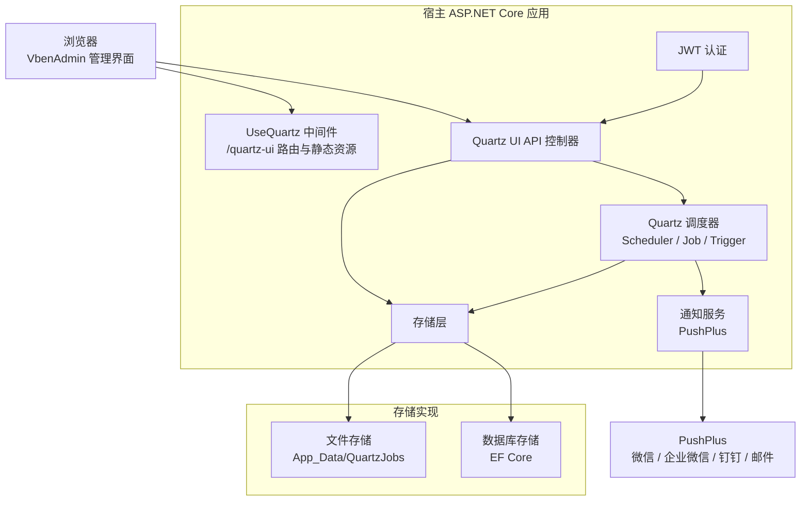
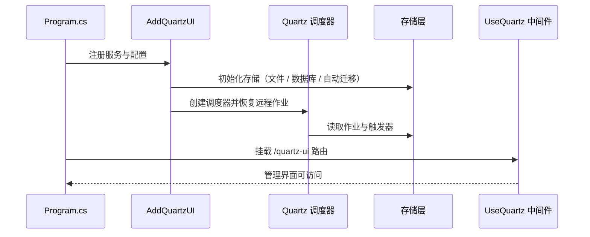

# 核心架构

## 1. 整体结构

Chet.QuartzNet.UI 以 **Razor Class Library（RCL）** 形式打包，直接嵌入宿主 ASP.NET Core 应用，不单独部署服务。



## 2. 分层职责

| 层 | 项目 / 组件 | 职责 |
| --- | --- | --- |
| 接入层 | `Chet.QuartzNet.UI` | 中间件、控制器、静态资源、JWT 认证、UI 路由 |
| 领域层 | `Chet.QuartzNet.UI` | 作业调度服务、执行日志、通知编排 |
| 模型层 | `Chet.QuartzNet.Models` | 作业、日志、通知、系统设置等实体与 DTO |
| 存储层 | `Chet.QuartzNet.EFCore` + 各 Provider | 文件与数据库两种存储实现的统一抽象 |
| 宿主层 | 你的 ASP.NET Core 项目 | 服务注册、配置、中间件挂载 |

数据库提供程序通过独立的 NuGet 包按需引入：

```text
Chet.QuartzNet.EFCore
├── Chet.QuartzNet.EFCore.MySql
├── Chet.QuartzNet.EFCore.PostgreSql
├── Chet.QuartzNet.EFCore.SQLite
└── Chet.QuartzNet.EFCore.SqlServer
```

未安装对应驱动包时，数据库存储与迁移面板中的该选项不可用，避免把无关依赖带进项目。

## 3. 启动流程



关键点：

1. `AddQuartzUI(builder.Configuration)` 完成调度器、存储、认证与 API 的注册；
2. 若配置为数据库存储，启动时按需执行 EF Core 迁移建表；
3. 调度器启动后会从存储中恢复作业，ClassJob 也会在此时完成扫描注册；
4. `UseQuartz()` 负责挂载管理界面与静态资源，默认入口为 `/quartz-ui`。

## 4. 一次管理请求的链路

以「在界面中暂停某个作业」为例：

```text
浏览器 → JWT 认证 → Quartz UI API → QuartzJobService
       → 更新存储中的作业状态
       → 调用 Quartz Scheduler 暂停触发器
       → 返回结果给界面
```

所有写操作同时更新**存储层**和**调度器内存状态**，保证应用重启后作业状态可以恢复。

## 5. 作业的两种形态

| 形态 | 说明 | 适用场景 |
| --- | --- | --- |
| ClassJob（DLL 模式） | 继承 `IJob` 的 C# 类，通过 `[QuartzJob]` 特性声明元数据，启动时自动注册 | 需要访问业务服务、依赖注入、复杂逻辑 |
| API 模式 | 配置 HTTP 地址、方法、请求头、超时与请求体，由框架发起调用 | 触发外部接口、跨服务集成、无需改代码 |

两种作业在管理界面中统一展示、统一记录日志，也都可以配置重试、依赖与通知。

## 6. 存储抽象

上层服务只依赖统一的存储接口，因此：

- 文件存储与数据库存储可以共用同一套 API 和界面；
- 同一份作业数据可以在五种存储之间迁移；
- 切换存储只需要修改配置，不需要改动业务代码。

具体差异与选择建议见 [存储模式](/guide/storage)。

## 7. 认证与安全

- 管理界面与 API 统一由 JWT 保护；
- 账号密码来自 `QuartzUI` 配置节，登录后签发 Token；
- Token 过期后前端会自动跳转登录；
- 数据迁移中的数据库连接字符串只保留在服务端，不会下发到浏览器。

配置细节见 [配置说明](/guide/configuration)。
